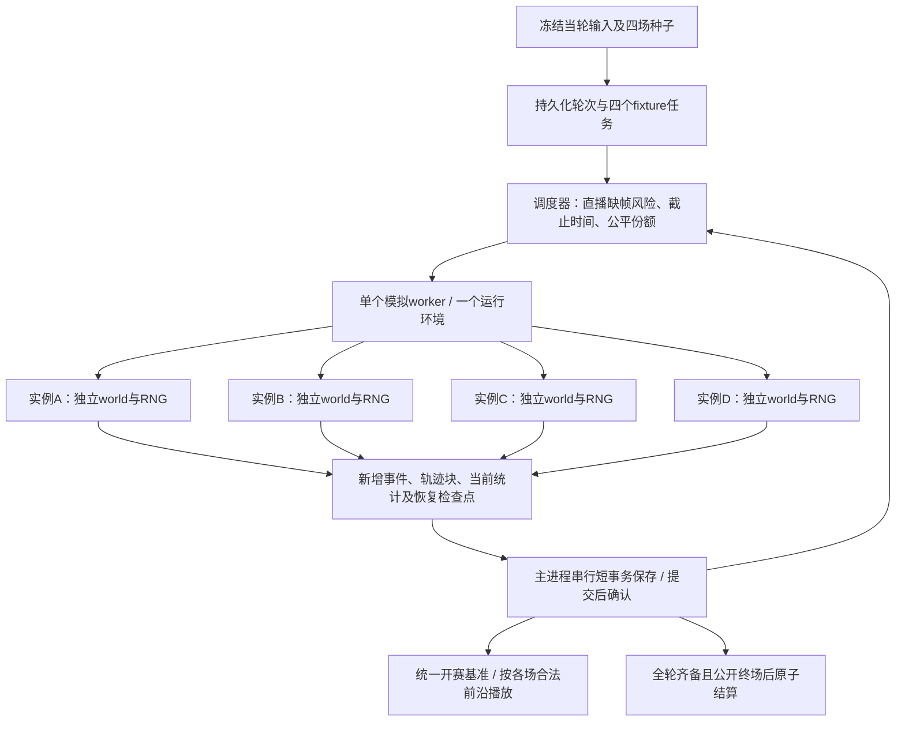

# 联赛当轮全部比赛并发推进方案 v1

状态：2026-10-20用户在容量未达标后明确选择保留现机、先上线底线修复，四场暂不开启。并发实现保留于feat/four-fixture-boundary候选，本次发布不包含调度/存储/入口拆分。下文为后续参考设计；实测见[容量记录](CAPACITY_V0280_20261020.md)。

## 1. 目标与可行性结论

以当前8队联赛、每轮4场、每场常规90分钟、5倍速观看为范围：四场比赛在同一轮内并发推进，玩家无需等待一场完整算完才开始另一场。每场保持20Hz物理、原球员决策和独立随机数，观战继续读取5Hz实际轨迹；一场只计算一次，连接观众不生成新比赛。

现有约1GB VM优先采用“一个模拟worker持有四个独立赛事实例，按小片段轮流推进”。这是四场**并发推进**，CPU执行各片段时依次计算；若要求四路硬件同时执行，应使用有足够CPU与内存、经压测合格的计算资源。当前机器不能凭2个逻辑CPU就承诺四路加速。

本方案在架构上可行，但当前VM的容量结论有条件：完成内存减负后，通过第8节实测门槛，才启用四场5倍速。未通过时保持现有发布版本，补足计算资源或继续优化后复测，不降低物理精度、修改足球决策或伪造进度来通过验收。

范围是**当轮所有比赛**；14轮赛季仍逐轮推进，后续阵容、训练、年龄、战术等输入到对应轮次才冻结。

## 2. 已知现状与缺口

2026-10-20 09:53 UTC只读检查：VM有2个逻辑CPU、952MiB RAM、无swap；当时可用674MiB、无活跃比赛。游戏服务MemoryMax=512MiB，空闲/浏览时约102MiB。此前运行版本曾触及服务内存限制；新版四场峰值尚未测量。可用内存会波动，空闲读数不是并发容量证明。

现有实现：

- `competitions/index.mjs`冻结整轮四场输入；`work.index`只指向其中一场，先完整计算本队，再推进其他场次。现有“最多3个未结算任务”计的是轮次任务，不是3个比赛槽。
- `simulation-worker.mjs`只有一份当前generator，换场通过`engine.return()`释放旧world。一个worker目前不能保有四场可随时继续的上下文。
- `simulation.mjs`每个durable切片生成累计报告和检查点；其中包含历史事件、统计快照、此前轨迹。玩家轨迹同时已经写入`match_chunks`。
- 结算`persistChunks`集中解压所有轨迹块、拼接、重新压缩，有瞬时副本峰值。
- 主进程经game/competitions/matches入口也加载物理模块；不能只改一条版本常量导入就宣称已解除全部加载链。
- 当前是每位经理一个独立8队世界，匿名Cookie识别存档，部分规则以`me`识别玩家；共享多人联赛的身份、权限及世界模型尚不存在。

这些缺口需要实际实现；本文件没有改变现有容量上限或产品承诺。

## 3. 运行结构与调度

一个worker内用`Map<fixtureId, SimulationContext>`保有四场。每场有独立generator、Rapier world、actors、RNG/rulesRNG、统计、待处理动作和tick；只共享不变的代码/资源。审查模块级缓存和临时预测world，禁止跨场写入队伍、随机状态或物理对象。

调度切片先试每场1～3个模拟秒，再依据切片耗时实测选定；每片仍逐个执行20Hz物理步。目标单片CPU占用P95不超过100ms，若慢则在合法整数tick边界细分。调度器在引擎外量耗时，纯模拟不得读取墙钟改变决策、物理步长或随机调用。

调度与持久检查点分开：让出执行权不等于复制整场历史。检查点初始候选为每5～15个模拟秒持久化一次，实际间隔由恢复成本和写入压测决定；中断最多重算上个已提交检查点后的片段，不能重新抽取种子。

调度选择：先处理即将耗尽观看缓冲的比赛，再比较各场距截止时间的余量，同时保证其他场次持续推进。AI场次也必须有公平份额，避免“本队先算到90分钟，其余才开算”。无人观看仍继续计算；掉线不取消任务，也不改变阵容/战术输入。

候选私有计算领先量为30～60个模拟秒，不是客户端可提前下载的范围。拥有足够领先量时主动把CPU交给落后的场次；缓冲值只影响调度，不影响足球行为。

后续若实测CPU有余量而单worker成为瓶颈，可用相同任务协议试2个worker，各自处理2场。四个worker不作为当前VM默认选项：多份运行环境和主线程竞争可能使内存、延迟更差。

## 4. 内存和存储方案

| 对象 | 生命周期与保存方式 |
| --- | --- |
| 联赛冻结计划 | 一轮一份，不在四个fixture任务里各复制整个世界；每场只传两队的不可变竞技输入 |
| 当前模拟上下文 | 每场只保有继续计算必需的状态；四个world持续驻留，避免每轮切片恢复/重建 |
| 位置轨迹 | 固定大小Uint16Array块，提交后交还/释放，不在每个检查点附带此前整场轨迹 |
| 事件和后台诊断 | 分块追加归档；决策/统计确实需要的上下文与累计计数留内存，历史记录从存储按需读 |
| 统计时间线 | 按时间块保存，直播常驻当前/邻近快照，完整历史从已提交块读取 |
| 检查点 | 当前world/actor/RNG/待处理动作、计数、日志序号及已提交块前沿；历史通过引用复原 |
| 线程消息 | 传新增数据和当前统计，ArrayBuffer明确所有权转移；不同时保有累计报告的多份深复制 |
| 写入队列 | 按字节限制且有背压；未提交数据不允许无限积累或公开 |
| 完整回放归档 | 逐块解压/流式重压，保留现有可读格式，避免全量Buffer.concat峰值 |

非玩家AI比赛现已不录完整轨迹，继续只保留真实战报/统计；所有场次仍使用相同物理和决策。在未来四场都有真人参加时，容量压测必须把四场都设为录轨迹，不能以“一场录轨迹＋三场AI”的低开销代替多人场景。

原始轨迹规模：5400秒×5帧/秒×49个uint16×2字节≈2.52MiB/场；四场约10.1MiB。它不代表整场内存：world、JS对象、WASM、检查点、压缩、SQLite缓存和临时副本都要计入。

主进程拆分轻量业务入口与模拟入口；后台同步simulate兼容调用保留明确路径，HTTP业务不隐式初始化Rapier。重构后检查实际导入图和基线内存，而非仅检查文件名。

内存按整个服务cgroup测量，避免把各线程报告的进程RSS相加。Node的worker堆限制不能覆盖全部ArrayBuffer和外部内存，不能把“4×128MiB堆上限”当作实际预算。[Node worker_threads文档](https://nodejs.org/api/worker_threads.html#new-workerfilename-options)

## 5. 开球、观看、缓冲与统一发布

保留点击后立即进入观赛壳、首片可看、退出继续、5倍速、防剧透及AI后台运行的契约。无须等完整比赛或整轮计算结束。

当轮有持久开赛基准T0。四场在同一轮任务接纳时进入可调度集合，当前玩家首批数据就绪即可启动观战；AI轨迹/完整结果不作为本队观看门槛。未来共享联赛可使用预定T0，开球前冻结双方输入；不能因某经理未打开页面推迟其他人。

正常容量内，各场公开目标时间沿同一T0以5×推进，但实际可返回内容仍受该场已提交数据前沿约束。比赛重开、结束时长和可能的中止使用真实规则，不强行裁成相同帧数。

- 每场接口只公开当前观看时刻的比分、事件、累计统计；坐标预取沿现有最多10个模拟秒的规则。私有30～60秒领先量不会整体发给浏览器。
- 同场双方和多窗口共享一个公开时钟和同一批帧；一场不会因两个经理观看计算两次。
- 真缺帧时仅该场进入明确缓冲状态，恢复后不跳过未观看的事件；其他场次继续。故障时不能同时保证“所有场次永远同一秒”与“任何一场都不受其他场影响”；本方案优先保留后者，并将漂移计为容量/可用性异常。
- 不通过暂停整个联赛来等待AI，也不降低20Hz、改用粗略比分或减少合理射门来弥补计算不足。
- 四份最终报告全部落库且要求播出的比赛都到公开终场后，再原子更新积分/资金/球员和轮次。计算提前结束仍不能提前公开。当前独立世界只对本队做公开终场门槛；未来共享联赛对全部真人参赛场次统一处理。
- 某场失败时保留已播进度和原始输入，在原版本/检查点恢复；其他已算结果私有保存。正式结果继续等待本轮完整发布，不留下半轮积分或重复工资。

同时开赛是可用性目标，不是过载下无条件承诺。压测不合格时不启用四场模式；运行中不足时如实显示缓冲并告警后台，不能靠隐瞒延迟宣称通过。

## 6. 任务、恢复和一致性

拟新增/拆分的逻辑记录（实现时再确定schemaVersion和迁移）：

- `league_round_jobs`：世界/联赛/赛季/轮次唯一键、冻结输入版本、开赛基准、状态、结算标识。
- `fixture_jobs`：稳定matchId、双方clubId、seed、引擎/参数版本、已提交tick、检查点、状态及分配代次。
- `fixture_chunks`：matchId＋streamType＋seq唯一，保存时间范围、校验值和payload；检查点引用同一提交前沿。

只有主进程写SQLite；worker只计算、发送结果。每份增量先在短事务中保存块/检查点/前沿，提交成功后ACK，才推进持久状态并公开。失败保留上次提交；重试按matchId/seq幂等，校验内容不符则报错，禁止覆盖。多worker未来加入时用分配代次/租约拒绝已失效worker的迟到结果。

SQLite WAL支持读写并行，但同一时刻只有一个writer；因此不让四个worker同时持有写事务。[SQLite WAL并发说明](https://sqlite.org/wal.html#concurrency)

完整轨迹和报告在工作区分块准备好，最终结算事务只提交权威结果/引用和去重标识，不在持有写锁时解压重压全部历史。提交前内容不进入正式公开接口，孤立工作块可在验证后回收。

最终轮次事务复核冻结版本、四场身份/种子、报告完整性及唯一结算键；一次性提交积分、出场/体能、训练/工资/收入、赛程及结算完成。禁止每场各扣一次周工资，或两个经理各结算一次同一场。

共享多人联赛是后续独立阶段：需要正式经理身份/球队成员关系、全局稳定clubId替代`me`作为赛事实体、联赛权威状态及每队操作版本。轮次输入冻结后，涉及本轮的阵容/战术/转会写操作有明确锁定；其他经理独立操作不能覆盖整个世界。不能把八个独立存档的赛果拼成共享联赛，也不能复制每个观众一份全联赛后分别结算。回放仍按球队归属授权，其他球队仅战报，后台诊断保持私有。

## 7. 容量计算与资源选择

定义总吞吐C为实测“所有场次推进的模拟秒之和÷墙钟秒”，包括调度、持久化、压缩和正常观战负载。N场、观看倍率v时，持续需求至少N×v；建议容量门槛取该需求的1.25倍。仅测单场最快片段再乘CPU数不能作为证据。

| 当轮场次 | 5×最低持续吞吐 | 本方案验收目标C | 常规90分钟总计算量 |
| --- | --- | --- | --- |
| 4场（8队） | 20比赛秒/墙钟秒 | ≥25 | 21,600比赛秒 |
| 10场（20队） | 50 | ≥62.5 | 54,000比赛秒 |
| 10个8队联赛同开，共40场 | 200 | ≥250 | 216,000比赛秒 |

4场常规90分钟在5×下播出约1080墙钟秒，即18分钟。C=25时纯计算总墙钟量约864秒，留216秒余量；这是容量算式，不是已测耗时。总吞吐合格仍须每场的缓冲与公平性合格。

容量测试分为满载计算档与正常5×播放档：满载档在相同观战/持久化负载下持续推进，测可用C与峰值；正常档可在各场领先充分时让出CPU，检查实际时限与卡顿。不能要求生产为了凑C≥25持续空耗CPU，也不能将主动节流后的吞吐当作机器最大能力。

当前VM默认只接纳一个四场轮次组，其他联赛轮次留在持久队列；这不代表可以同时服务多组预定开球的真人联赛。接纳前要同时保留CPU预算、内存和首片时限；预定开球无法满足时应提前扩容/调度资源，不能到开球后才发现无限排队。

初始验收资源预算为整个游戏服务cgroup峰值≤400MiB，沿现有512MiB硬限制留出余量；VM可用内存最低≥150MiB，OOM/OOM-kill/服务重启均为0。400MiB是待验证的工程预算，不是已实现的单场/四场占用，也不授权上调现有MemoryMax。

资源路径：先在现机试1worker＋4上下文；合格后支持一个四场组。若内存合格但吞吐不足，测2worker方案；若任一门槛仍失败，使用更多有保障的CPU/内存或独立计算节点。跨机只传冻结输入/版本和增量输出，数据库仍由权威服务写；远端需要认证、超时、代次及相同确定性验收，不在本阶段增加新常驻服务。

## 8. 分阶段实施与验收

本节是本功能的专项设计，保留现行AGENTS、分层测试、Node22/24、模块锁、PR、备份和部署规则；不修改CI、测试触发映射、现实统计阈值或日常开发流程。本文档阶段不启动物理比赛。未来实施按实际差异分类；改到引擎/检查点执行路径需要既有相关专项，轮次持久化/原子结算等重大流程需要受控业务赛季，不能借容量优化绕过。

**阶段一：内存减负和基线。** 拆累计报告/检查点，分块历史和流式归档，解除HTTP隐式物理加载。用固定输入比较旧/新单场的RSS、cgroup峰值、堆/外部/ArrayBuffer、写入量、CPU和接口延迟；各阶段标出采集口径。保持竞技输出相同，不能用仅heap下降代替整体内存下降。

**阶段二：现有AI联赛四场并发。** 轮次下拆四个fixture任务，1worker多上下文，调度与检查点分开，ACK/幂等/恢复。保持现有独立存档、观看权限和原子结算；不同时引入完整账号系统。

**阶段三：隔离容量验证。** 使用脱敏/新建固定输入，不推进生产赛程。在目标VM同规格隔离环境或受资源限制的独立维护环境运行；本次方案实施授权范围须明确包含容量用真实比赛专项，未获实施授权前不运行，也不将其加入普通迭代或日常CI。复用同一批报告作真实性/确定性证据，避免重复无关物理赛季。分两组：当前一场录轨迹＋三场AI，以及未来四场都录轨迹。测试1worker，再按需要测2worker，不把2worker默认视为更快。

| 项目 | 必须看到的证据 |
| --- | --- |
| 竞技一致性 | 同引擎/参数/输入/种子，顺序、四场交错、不同调度次序及中断恢复后，赛果/事件/每帧轨迹一致；仅持久包装格式可变化 |
| 持久恢复 | 任意场检查点边界、未提交片段、ACK前后、归档和结算前后中断，恢复不丢帧、不重结算、不换种子 |
| 流程一致性 | 既有重大流程层级下跑受控业务赛季，验证每轮四场、训练/工资/体能/积分、换季和重复请求 |
| 吞吐 | 四场全轨迹满载档完整运行C≥25，报告60秒窗口的最低/中位吞吐；正常播放档逐场按时补帧、无缓冲耗尽；另查每场是否饿死，不能仅报整轮均值 |
| 首片和观看 | 点击到本队首批已提交可播轨迹P95≤3秒；不等其他场整场结束；正常负载无缓冲耗尽，退出/重进保持进度 |
| 直播读负载 | 当前模式测本队合法连接；四场全录制容量档用隔离授权适配器提供8个连接（每场双方各1个），另测重复打开到16连接；本机直播/状态API P95≤250ms，公网延迟另报网络口径。真实共享权限仍在阶段四验收 |
| 内存 | 运行、检查点、终场归档、结算各阶段cgroup峰值≤400MiB；VM最低可用≥150MiB；无OOM、重启、持续增长，不能只采空闲时刻 |
| 防剧透与权限 | 当前事件/比分/助攻/射门随公开时钟；10秒坐标缓冲边界；隐藏真值/诊断；跨球队轨迹访问被拒绝；多窗口不重复计算 |
| 过载/公平 | 额外轮次不突破接纳预算；慢场可恢复且其余继续；故障漂移/缓冲计为异常，不作为正常同步通过 |

四场全轨迹至少使用3组完整轮次（不同队伍/种子、含高事件/高强度场景），并覆盖反复开关观赛及轮间空闲；不能只用开场几秒判断峰值。若执行路径未修改足球算法，复用同输入输出做一致性，不额外为纯文档/界面重跑比赛。验收目标用于此功能，没有修改足球现实性阈值。

阶段三通过后才在现机启用四场组；现有生产数据先备份并核对离机副本。检查点格式不兼容时排空旧任务，用创建任务的旧版本恢复，不拿新格式强行接旧任务。迁移使用新增表/字段保留旧数据；回退新接纳模式时，活动的新任务先完成或停在可恢复状态，不能把旧程序直接指向未知schema。

**阶段四：共享多人联赛。** 另行实现身份、共享世界、权限、同时冻结和统一结算，再复用上述调度协议。必须在8个真实权限主体的隔离业务用例下重新验证，当前单存档原型不能冒充真人PvP。

## 9. 模块归属与实施范围

| 模块 | 预计职责 |
| --- | --- |
| server/integration | 调度、上下文管理协议、SQLite分块/ACK、公开投影、授权、进度、资源采集与恢复 |
| shared/matches | 可分段推进与紧凑恢复状态、增量记录；保持原物理/决策/RNG顺序，维护对应决策参考摘要 |
| shared/competitions | 一轮四场身份/输入冻结、完整性校验、统一结算及未来共享联赛权威状态 |
| client/matches与competitions | 当前场流式观看、缓冲/退出重入，其他场仍仅战报；不公开工程诊断 |
| deploy与docs | 经验证的资源配置、迁移/备份/回滚说明；资源增加另列实测理由 |

0.28候选映射：match_jobs协调轮次，新增match_fixture_jobs/logs/tracks，本队帧兼容match_chunks；每5模拟秒切片，表版本4、存档版本3。HTTP改用management经营入口、metadata版本入口和纯竞赛结算，不再加载物理；同步game兼容入口及worker仍加载真实引擎。新增导入图回归，并按整个服务重新验收，不能仅凭移除一条import宣称节省。共享世界/账号/预定开球/多节点后续加入。

首次目标VM隔离容量尝试未形成通过证据：启动后HTTP/SSH未响应，停止指令无法确认送达，用户从Oracle控制台重启。独立测试目录和服务没有替换线上代码；原因待恢复后读取日志确认，确认健康和资源保护前不继续压测。
