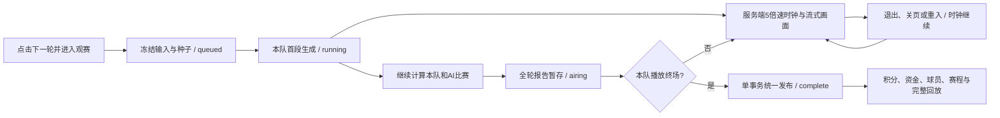

# 0.7.0 五倍速观看与延迟结算

用户于2026-10-18要求：下一轮自动实时观看、退出后继续、菜单重入、不等整场计算完成、不提前公开赛果、AI后台计算且整轮统一结算。本契约取代CONTINUITY_AND_WATCHING_V3的双入口、12×默认及计算完即结算。2026-10-26的`0.44.0-live-manager`补充本队临场指挥；它在下一物理片段应用，不改变物理时间/引擎事件规则、AI比赛或延迟发布门槛。

## 0.44 本队临场指挥

- 仅本队实时任务公开管理面板。选中本队球员时，客户端以球员 ID 关联任务管理档案中的六项公开大数据；不从实时轨迹或属性推导细项。旧历史报告没有这份快照时不展示虚构值。
- 阵型限定4-4-2、4-3-3、3-5-2；风格为均衡/控球/反击/边路，压迫为低/正常/高。改变会更新真实的球队阵型职责与球员目标，仍通过后续正常决策/移动生效。
- 替补最多5人，只能以同天然大位置的未登场替补换下未被罚下的场上球员。替补占用同一阵型槽位职责；计数、事件、体能与评分仍归各自球员 ID。
- 命令按存档和任务所有权验证、以`requestId`幂等，在正在执行的物理片段之后的下一片段应用。最后片段可能与命令并发；若本队物理模拟已结束，指令标记“未生效”，不修改终场结果，并释放预留换人名额。模拟结束后拒收新命令。
- 直播报告保存适用的战术变化/换人事件，使轨迹重放与统计身份连续；AI、历史回放以及比赛结算门槛不接受命令。实时状态只公开已投影的六项摘要，不公开隐藏细项、指令原始体或诊断数据。

## 时间与状态

- `broadcast.mjs`只负责展示时钟及公开投影，不能进入simulate、RNG、Rapier或战术输入。`speed=5`固定；以服务端UTC的`anchorAt`和`anchorSecond`恢复当前进度，不依赖浏览器时间、连接数或是否观看。90分钟约18分钟，点球、初始排队或实际缓冲另计。
- 首段就绪即开始时钟，500ms服务端pulse；页面以`performance.now()`平滑插值，不能提交时钟、暂停或提前结算。离开、刷新、关闭页面不改变服务端进度；服务器停机期间已有帧足够时也按持久时间继续。
- 真正断粮时停在最后可用物理秒，持久保存新锚点，新增数据后按5×继续，不跳过尚未播出的时间。不能承诺在CPU/内存过载或排队时绝不缓冲。
- `ownComplete`在公开接口表示本队**播放**完成；私有progress同名字段表示本队**计算**完成，严禁直接展开私有progress给客户端。`airing`表示所有报告算完但尚未发布。
- 若观看终场时AI还没算齐，显示“正在确认本轮结果”，本队画面照常完成，计算齐全后统一结算。浏览与观赛可用，整轮正式提交前存档写操作仍锁定。

## 计算、片段与防剧透

- 保留单个worker与最多3个未结算任务，512MiB服务/每线程128MiB堆上限不变。本队先算、15物理秒一片；AI不记录轨迹、60秒一片。调度优先未完成本队；多个本队按最近计算时间轮转，当前正在执行的片段先完成，不并行增加worker。
- POST advance/cup立即返回202；客户端先进入观赛壳，标明赛前站位，第一小片出现即绘制。AI无须计算完，更无须等整场/整轮算完。
- SSE仅发送当前时钟/状态摘要。观赛时约每秒取报告和增量帧；退出后只保留进度，不持续下载轨迹。轮询作为断线备用。
- GET `/api/match-jobs/:id/frames?from=N`按帧返回98字节/帧的小端uint16数据，gzip传输，头`X-Frame-Start/End`为起点和排他终点。非法/未来范围416、跨存档404；49值/5Hz编码不变。为网络与插值允许**最多10个物理秒（2个墙钟秒）的坐标预缓冲**，不是完整未来轨迹；客户端只显示当前时刻。
- 活跃job的report按时钟过滤事件、比分和最近统计快照，未到时不返回点球结果、中止状态、全场统计或未来事件；普通事件保留最近120条，进球/红黄牌保留。不要从最终report复制任意新字段到直播投影。
- 新任务未正式提交时，旧`chunks/:seq`接口返回409，完整report/replay尚未写入正式表，不能绕过播放器提前读取最终结果。完成任务和历史轨迹继续兼容。

## 原子提交与恢复

全轮报告和原输入压缩保存在work，`airing`不释放未结算锁。只有播放终场且报告齐全，才在同一个BEGIN IMMEDIATE中核对revision，执行原settleCompetition并提交save、report、replay、operation和complete。资金、AI比分、积分、体能、日期和排名一起更新。交易失败全部回滚，work不丢失；恢复发布阶段只重试提交，不再模拟比赛。重复点击/标签页仍加入原任务，不能重抽。

JSON schema3、SQLite表3和历史报告不变；progress只增加broadcast/chunkEnds/computedAt字段及airing状态。旧完成任务按原契约读取。升级前排空旧未完成任务；回滚不认识airing的版本前也必须排空新任务，或保留最新完整快照并按版本恢复，不能只切代码处理进行中任务。运维见根docs/OPERATIONS.md。

## 维护与验证

0.7.1客户端修补：时钟消息按serverNow顺序合并，receivedAt在消息到达时记录，画面异步下载不能把旧时间重新盖成当前时间。运行状态持续按五倍速外推，不因网络抖动回退；buffering/finished仍由服务端决定。报告与帧并行请求，先更新时钟摘要再提交已解码画面；稳定动画循环读取最新ref。物理、服务端锚点、10秒坐标缓冲、防剧透和统一发布不变。受控浏览器0/650ms请求/响应延迟各观察约7.6秒，均未见>=100ms坐标冻结；0.7.0相同请求延迟此前9次冻结共2465ms。此为流程/呈现证据，不是物理性能验证。

运行归属：server/broadcast.mjs时钟/脱敏；match-jobs.mjs调度/发布；storage/jobs.mjs持久化；client/modules/matches观看与重入；competitions单入口；main.tsx组合。改动必须更新各模块CHANGELOG与本契约。比赛决策图仍对应未变的0.6.1算法，不把观看倍率加入物理速度公式。

`tests/live-round.test.mjs`用受控报告与可控服务端时间验证18分钟门槛、离开/重启、失败恢复和本队优先；`live-http`验证真实HTTP/SQLite/worker传输、Cookie隔离、未来数据不可读；浏览器受控60秒报告验证首次流式观看、固定5×、退出/重入/刷新、终场与赛后回放。测试预加载只能由显式Node测试CLI提供，生产没有假赛果开关。按已批准分层规则执行完整14轮业务赛季，不因观看变化重跑真实物理。未来变更时同步维护验证映射，开发流程不变。
