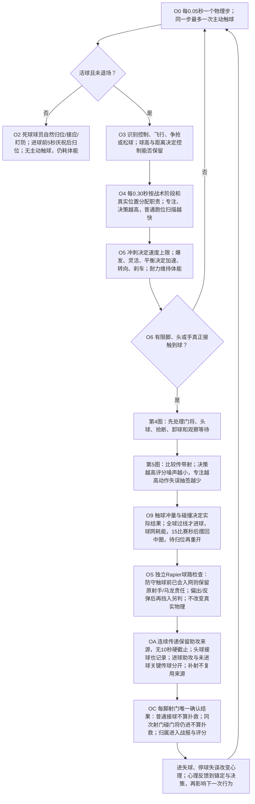
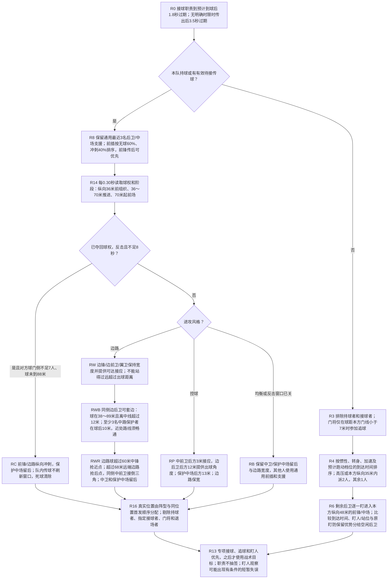
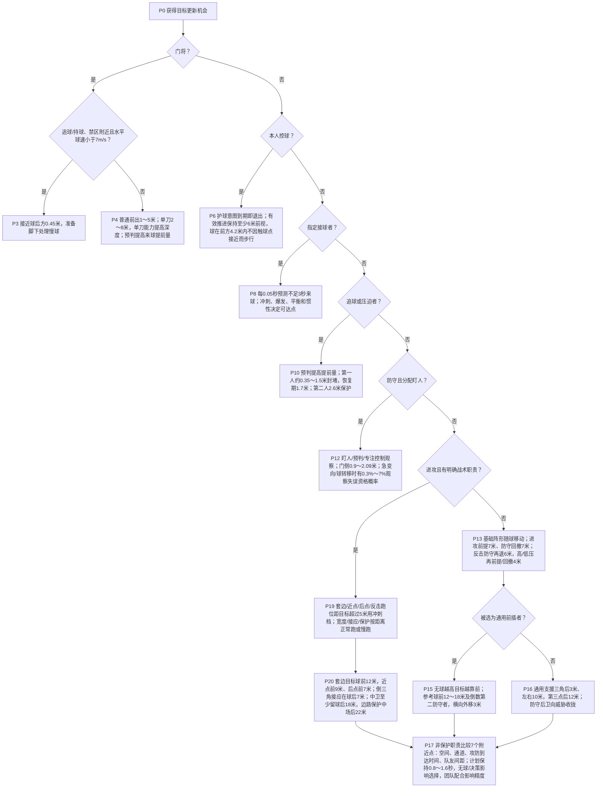
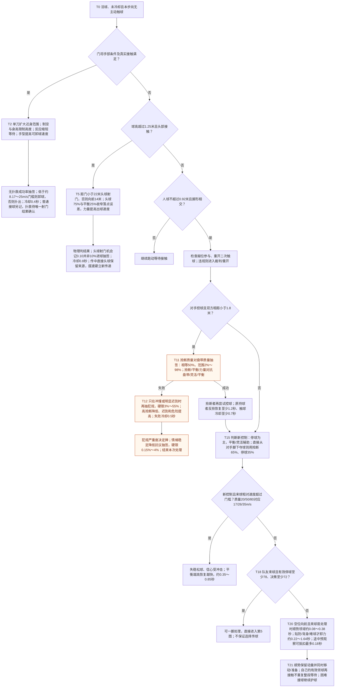
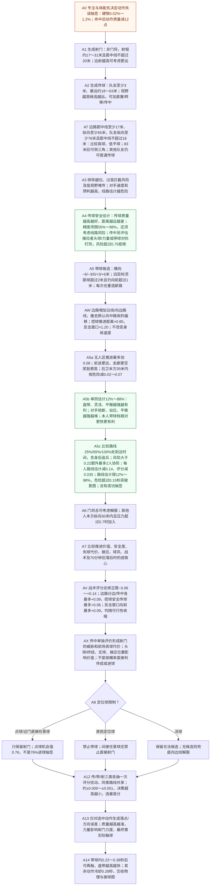
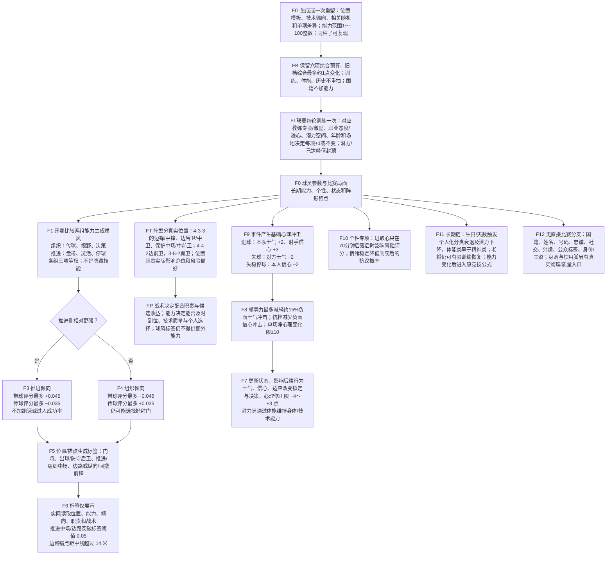

# 球员决策树：触发数值、概率与属性实战效果

引擎：`0.15.1-attribution` / `movement-1`。统计归属以[STATISTICS_V0151.md](STATISTICS_V0151.md)为准：第1/4图新增射正折射/乌龙责任、连续助攻来源及唯一射门结果；原运动参数/战术评分保留。当前接球推进/无球博弈/死球移动以[MOVEMENT_V0140.md](MOVEMENT_V0140.md)为准，取代下文旧版运动说明。依据基线提交 `6d888497edd52b016b8edd535b209a4046b66bc4` 核对，日期：2026-10-19。0.11.0更新球员数值分布与第6图：位置模板、技术偏向与相关随机差异进入原有30项能力，旧档显式重塑一次；比赛跑位/决策/物理/评分公式不变。战术/位置协同、球网、运动参数、5×播放和终场门槛保留。正文按相关性和影响因子说明，不列具体公式；细节见[球员分布](../../players/ATTRIBUTE_PROFILES.md)、[战术专项设计](TACTICS_V0100.md)、[运动参数](PHYSICAL_MOTION_V061.md)及源码。

0.12.0新增第9节知识可见性图：前六图全部读取服务器真实能力，公开卡片/评估区间不反馈竞技；逐项审计见[ATTRIBUTE_AUDIT.md](../../players/ATTRIBUTE_AUDIT.md)。

0.15.0当前30项基础能力采用1～100整数，训练每轮每项判定+1或不变；当前旧球员只四舍五入（差≤0.5），不重新分配。有效能力、速度、概率仍保留连续精度；第6/9图同步。见[整数契约](../../players/INTEGER_STATS.md)。

阅读顺序：总览 → 无球职责 → 跑位 → 接球/对抗 → 传带射 → 球风与完整属性索引。图中节点编号与紧随其后的说明表对应。[总览 SVG](decision-map/01-overview.svg)、[职责 SVG](decision-map/02-roles.svg)、[跑位 SVG](decision-map/03-positioning.svg)、[接球 SVG](decision-map/04-reception.svg)、[持球 SVG](decision-map/05-actions.svg)、[球风 SVG](decision-map/06-profiles.svg)可独立打开并放大；Mermaid 是可编辑来源，SVG 是同步导出副本。

先分清数值的含义：

| 图中标记 | 实际含义 | 不能这样理解 |
| --- | --- | --- |
| **抽签概率** | 代码确实取一个随机数比较；相同输入和种子可复现 | 每次接球、每个物理步都重复抽签 |
| **估计值** | 用来评估候选动作，例如传球安全度、带球成功估计、机会xG | 系统按此数值直接判传成、过人或进球 |
| **评分修正** | 让某动作在候选比较中更有竞争力 | 加0.04等于成功率加4个百分点 |
| **门槛/时间/距离** | 符合条件才进入分支，或决定目标与执行节奏 | 能力更高就一定得到球或打败对手 |
| **物理结果** | 有限脚/头/手接触、冲量、碰撞、减速和规则共同决定 | 传球80就是80%成功，终结80就是80%进球 |

下文“能力”默认为赛内**有效能力**，范围1～100；体能、心理、惯用脚和贴身压力的影响见第1、4、6节。所有概率均针对注明的触发机会，不是整场发生率或每秒概率。“硬限”是截断保护边界，不代表合法输入一定能达到两端；典型值另列。图中橙色节点含真实抽签，绿色节点为候选成功估计，其余为条件、执行或说明。

## 1. 总览：数据何时进入决策

| 节点 | 当前数值与影响因素 | 球员数据的实战效果 |
| --- | --- | --- |
| O3 控制保留 | 球低于1.3米；近控小于2.6米/相对球速3.5m/s，快带小于4.2米/4.5m/s；仍需近身、刚建立控制或有效带球意图 | 保留追领球职责，不授予远程触球；脚触仍≤0.92米且形状相交 |
| O4 普通扫描 | 专注与决策共同决定计划间隔，理论约0.10～0.65秒；只在0.30秒团队更新点检查是否到期 | 更高数值减少目标更新滞后；不等于每0.10秒重算全队。门将目标另外每0.10秒更新 |
| O5 体能 | 赛内体能最低20；高压消耗倍率1.20，正常1，低压0.85；门将位置基础倍率0.45；跑得更快消耗更多 | 耐力越高掉体能越慢；疲劳降低冲刺、爆发、灵活、平衡、力量和技术能力，间接影响后续跑动与处理球 |
| O5 有效能力 | 满体能不折损；体能20时身体能力约保留83.4%，技术能力约90.4%；心理对镇定/决策修正限制为−4～+3点 | 此处不是统一扣减所有属性。视野、预判、无球、防守站位、团队配合和专注没有单独的体能乘数 |
| O6 真实接触 | 脚、头、手各有有限体积；普通脚触还要求人球水平距离不超过0.92米 | 位置、身高、速度与到达时机决定能否参与；再高能力也不能隔空踢球 |
| O8 两类随机 | 动作失误抽签为0.02%～1.2%的限定范围；传/带/射各类评分噪声约±0.006～±0.051，同类候选共享 | 专注主要减少失误，决策主要减少选错候选；两者不是同一个抽签，评分噪声也不是百分比 |
| O9 执行 | 地面传球计划初速上限30m/s；所有主动触球请求初速上限38m/s；足球持续受草阻和空阻减速 | 球速不是固定值；更远传球需要更大力度，力量影响射门/头球等出球，不能越过统一接触和速度限制 |
| O9 入网与重开 | 全球越过门线、在门柱内且低于横梁才进球；后/侧/顶网恢复0/Min、摩擦1/Max，门口开放；进球后保留15比赛秒入网/庆祝，再摆中圈等待至少10秒且球员就位才重开 | 网面吸收冲击，门柱/横梁仍保持硬碰撞；不抽签判进、不吸附球、不改变球员属性与射门选择；乌龙触球者和受益队分开记录 |

统计节点OS/OA/OC无随机抽签、不读取能力制造归属：射正/乌龙按实际入球前触球球路；助攻按连续来源，防守介入的关键传球取消，折射助攻保守核对原接球对象。独立球路最多20秒预测与2.5米原传递走廊属于实现边界，不是助攻计时规则或现实官方阈值。详见[统计来源与兼容](STATISTICS_V0151.md)。

来源：[simulation.mjs](../simulation.mjs) `createMatchSimulation / attemptTouch`、[continuity.mjs](../continuity.mjs)、[match-state.mjs](../../players/match-state.mjs)。

## 2. 无球职责：谁追、谁盯、谁支援、谁前插

此图对双方分别判断。职责分配是排序和条件判断，**没有“愿意跑位”的独立随机概率**；第3图指定盯人的观察存在有条件的短暂失误抽签，不能与职责分配混淆。

| 节点 | 主要因素与实战效果 | 当前边界 |
| --- | --- | --- |
| R0 指定接球 | 传球对象与预计飞行时间决定保留多久，接球者优先赶向球路 | 接球职责过期仅影响本轮分工；正式传球完成统计另用10秒窗口，不能当成同一个时限 |
| R3～R5 追球/压迫 | 到达估计包含速度投影、逆向刹车、横向转向、爆发/灵活加速和预计跑动档；高压或本方35米内2人，否则1人 | 排序不是瞬间到达，真实身体继续受加减速限制；尚无完整视线遮挡 |
| R6 一对一盯人 | 空闲后卫按到达成本、盯人/站位选择；继续原对手有0.55秒保留优势；威胁仍按靠近本方球门排序 | 一人一防，减少无谓换防；之后观察允许有限延迟，不保证永远跟住 |
| R8 支援 | 通用近处后卫/中场提供传球三角；优先服从明确战术职责 | 新位置职责的中卫/保护中场不会再被通用最近三人支援拉进对方禁区；指定接球仍优先 |
| R9 前插 | 无球跑动是主要排序因素，冲刺是次要因素；无球高还使前插目标更靠前 | 不是无球80就有80%前插；前锋传后前插可以优先于排序，指定接球等职责仍可覆盖 |

来源：[positioning.mjs](../positioning.mjs) `teamRoles`。

### 战术、阶段与真实位置的影响（R14～R16）

这些是团队分工和评分条件，不是成功率。球权变化时间随检查点保存；接球准备、越位、压力和真实接触仍独立判断。

| 战术 | 无球分工 | 接球后候选倾向 | 限制 |
| --- | --- | --- | --- |
| 均衡 | 中卫/保护中场留后，边路保宽；其他人沿用支援/前插 | 比较安全、空间与推进；合理传中同样可选 | 没有强制短传，也没有固定传带配额 |
| 控球 | 中前卫球后3米、左右9米；边后卫球后12米、横向15米；保护中场后13米 | 安全传球最多+0.06；带球目标纵深为基础85%；无压且接应点空闲时过深回传小减0.015 | 缩短的是目标，不是球速/人速；存在好带球/射门仍可选 |
| 反击 | 真正夺回球权不足8秒，且对手球门侧不足7人、球未到88米时，前锋/边路向前约18～24米冲刺；保护中场留后 | 窗口内向前传球最多+0.09、带球目标纵深120%、空地带球额外最多+0.025；窗口外向前偏置最多+0.015 | 开球/重开不算夺回；队内传球不重置8秒；死球清空；对手落位或窗口关闭回到组织 |
| 边路 | 边路宽度目标距中线约27米，接应目标最多在球前14米，最低纵向38米；同侧边后卫有保护和通道时套边 | 向空闲边路点传球最多+0.09；可行传中最多+0.09；宽而空的带球路线最多+0.055，不默认向中路收 | 不能靠加分穿过封堵；没有禁区接应不生成普通运动战传中；球员仍可内切、回传或射门 |

| 真实位置 | 4-3-3安排与实际影响 | 其他阵型/边界 |
| --- | --- | --- |
| 门将 | 原有守门、出击与出球逻辑优先 | 不被团队进攻职责拉到套边/包抄 |
| 中卫 | 普通进攻保留至少球后18米，目标纵深上限62米；后场冒险传球再受风险惩罚 | 所有阵型都有；持球、追球、盯人优先，所以不是锁死位置 |
| 边后卫 | 同侧可套边，目标球前12米、距中线28米；另一侧收在球后20米保护 | 套边须球在38～89米、侧向超过12米，至少3名中卫/保护中场实际处在球后10米，近处15米路线无2.5米内封堵；持球边后卫不再招第二人套边 |
| 保护中场 | 边路进攻留球后22米，其余13米，纵向上限68米 | 4-3-3同位置首发第一名；4-4-2第二名中场；3-5-2第三名中场；未新增球员固定位置或职责编辑器 |
| 中前卫 | 同侧球后7米、距中线9米提供倒三角；另一侧后15米提供支援 | 控球时形成不同接应角；无球/团队配合控制目标偏差，速度仍由身体能力决定 |
| 边锋 | 4-3-3外侧两名前锋保宽并接应；边路球超过68米时远端转后点，目标球前7米且至少83米，距中线6米 | 4-4-2外侧中场为边前卫、3-5-2外侧中场为翼卫，参与同类宽度/远点分工；翼卫不冒充额外边后卫套边 |
| 中锋 | 边路球超过60米时抢近点：球前9米、至少81米，靠球侧距中线4米；双前锋的另一人靠反侧3米 | 与远端边路点不同，避免扎堆；候选目标参考防线，固定能力偏差后仍可能越位，真实裁判不跳过 |

阵型槽位按保存首发在同一GK/DEF/MID/FWD类别中的顺序分配；4-3-3前锋为左边锋/中锋/右边锋，中场为保护/左中前卫/右中前卫。4-4-2与3-5-2槽位见[专项表](TACTICS_V0100.md)。标签“组织型/突破手”仍由能力生成，与这里实际执行的positionRole不同。压迫设置独立改变追球人数、防线和耗能，不被进攻风格覆盖。

来源：[战术配置](../../tactics/presets.mjs)、[战术分工与估值](../tactical-plan.mjs)、[跑位](../positioning.mjs)、[球权时钟](../continuity.mjs)。

## 3. 跑位：目标优先级与实际跑速

从上到下首次命中的分支立即返回目标；不是所有属性对每一次跑位同时生效。

### 分支中的影响因素

| 节点 | 当前条件/数值 | 属性如何改变实际行为 |
| --- | --- | --- |
| P4 守门站位 | 对手在本方门前26米内控球、其后方7米内没有队友保护，触发单刀前出；预判的门线来球窗口不足1.5秒 | 单刀处理提高前出深度；预判提高横向预测量。反应影响真正扑球的等待，见第4图；未按“扑救成功率”直接结算 |
| P6 持球导航 | 护球意图须未过期；连续推进前视至少6米，旧目标被球追近2米即延展；球落身后0.8米或失去有效意图再追近 | 不把下一脚接触点当停车点，转向和实际接触仍受物理约束 |
| P8 指定接球 | 每0.05秒预测不足3秒来球，按实际接球档位和共享到达估计寻找可达点；预观察供第一脚准备抵扣 | 冲刺、爆发、灵活、平衡和当前速度影响可达；决策/预判减少后续准备，不能隔空控球 |
| P10 压迫 | 追松球的提前时间约0.12～0.42秒；第一人距持球者超过2.5米时先封线路，再贴近 | 预判更高使追球和压迫目标更靠前；抢断能力在真正触球后的对抗阶段才决定夺球抽签优势 |
| P12 盯人 | 门侧间隔0.9～2.09米；盯人/预判/专注决定观察约0.16～0.56秒，预判提高0.10～0.30秒提前量；旧观察总外推最多0.9秒 | 对手跑速>2且急变向>1.8m/s或球转移>7米、至少隔2.5秒才检查一次失误资格；无球/灵活对抗盯人/预判/专注及疲劳，资格概率限0.3%～7%；仅延迟观察0.35～0.944秒，不冻结身体或直接判摆脱 |
| P13/P18 阵形与职责 | 锚点改为三种阵型的真实位置槽位；普通进攻+7米、防守−7米；反击窗口普通进攻再+3米、防守−6米；高/低压防守±4米；普通宽度均衡1、控球1.08、反击1.05、边路1.18 | 先取R16明确职责目标，未分配才进入通用前插/支援；接球、追球、盯人等提前返回仍优先。各位置锚点见专项设计 |
| P15 前插 | 参考球前方约12～18米及倒数第二防守者位置 | 无球越高增加前插纵深；当前基础目标可能仍越过参考防线，不能声称从不越位，候选过滤和裁判另判断 |
| P16 后卫收拢 | 非指定盯人的普通防守目标，向附近前锋收拢权重限制40%～85% | 盯人越高越靠近威胁；这不是抢断成功率，也不影响先前已经返回的专项盯人分支 |
| P17 站位偏差 | 偏差种子开赛固定，随有效能力改变幅度，不是每步随机抖动；门将指挥最多将防守偏差额外缩小约10% | 进攻用无球，防守用站位，均由团队配合辅助；没有给全队能力统一加成。仅普通阵形/前插/支援等未提前返回的目标使用此项 |

### 跑动档位：按顺序选择，能力决定档位内的上限

| 首次命中条件 | 档位和关键数值 | 数据的实战效果 |
| --- | --- | --- |
| 本人控制球（优先） | 近控约冲刺上限60%～80%；空地快带约86%～96% | 盘带影响档内上限，不能因接近下一脚触球点自动步行 |
| 其他人距目标小于1.2米 | 步行1.5m/s | 避免到点仍冲刺 |
| 指定盯人者 | 目标距>4米或观察到对手跑速>5则冲刺；距>1.5米或对手>3则run，否则慢跑 | 观察滞后会影响追踪，仍受加减速限制 |
| 指定接球者 | 距球超过5米冲刺，否则正常跑 | 冲刺、爆发与当前惯性影响能否赶上 |
| 追球者 | 距球超过7米冲刺，否则正常跑 | 接近球时收速；不因抢断属性高而瞬移 |
| 被选前插者；或套边/近点/后点/反击职责且距目标超过5米 | 冲刺 | 职责改变何时用冲刺，无球影响目标偏差和候选价值；速度/加速仍由身体能力与体能决定 |
| 其他球员 | 距目标超过18米正常跑，否则慢跑 | 限制无关球员长时间全速奔跑 |

例如有效冲刺20/50/80时，冲刺档上限分别为6.42/7.50/8.58m/s，正常跑为4.74/5.40/6.06m/s，慢跑为2.98/3.40/3.82m/s。有效爆发20/50/80对应基础加速3.10/4.15/5.20m/s²；灵活控制对所需速度变化的响应，平衡控制刹车。它们共同决定真正加减速，不能把“上限8.58”理解为瞬间达到8.58。撞击后的异常人速保护为个人冲刺上限外约0.6m/s。

来源：[positioning.mjs](../positioning.mjs)、[locomotion.mjs](../locomotion.mjs)、[ball-motion.mjs](../ball-motion.mjs)。

## 4. 接球与对抗：真正的抽签发生在哪里

### 抢断、犯规与纪律

| 节点 | 概率、数值与影响因素 | 实战解释 |
| --- | --- | --- |
| T11 抢断抽签 | 抢断动作质量主看抢断70%，辅看平衡20%、力量10%；对方盘带质量主看盘带65%，辅看灵活20%、平衡15%。同质量50%；抢断质量高18点约73.1%、高36点约88.1%，反之约26.9%/11.9%；最终限制2%～98% | 这些是已经接触到脚下球并满足近身条件后的夺球概率。惯用脚、疲劳、镇定和压力会先改变双方动作质量；不是一跑到附近就能抽签 |
| T11 恢复 | 每次抢断尝试后1.6秒才可再次尝试；成功后原持球者另有至少1.2秒反抢恢复和0.7秒触球冷却 | 防止一帧内双方反复互抢；失败只终止当前处理，不保证对手一定能一直持球 |
| T12 犯规资格 | 必须先抢断失败；向对方逼近速度超过2.2m/s，或迟到程度超过0.65且相对速度超过1.2m/s，才抽犯规 | 普通站立争球直接不判犯规，不会无条件套用3%的最低概率 |
| T12 犯规抽签 | 中性基础18%；抢断越高越低，迟到和相对速度引起的危险越高越高；资格满足后限制3%～55% | 这是失败抢断的条件概率，不能解释为整场每次对抗有18%犯规。禁区位置决定点球/任意球，能力不改变禁区边界 |
| T13 黄红牌 | 危险程度至少0.90直接红；至少0.55或迟到至少0.75为鲁莽黄牌；明显进球机会被破坏另有黄/红规则，禁区内按当前简化规则处理；两黄变红 | 牌的严重度由规则确定，不再另抽“吃牌概率”。明显进球机会条件包含前场纵向超过82米、距中线小于12米、身后保护者最多1人 |
| T13 抗议抽签 | 发生相关判罚后才抽；情绪稳定20/50/80时约2.17%/0.80%/0.29%，硬限0.15%～4%；抗议会追加黄牌 | 情绪稳定当前影响此环节；没有直接增加抢断成功率，也未直接降低动作危险程度 |
| T9 规则 | 越位按触球时快照与之后参与判断；角球、边线球、球门球的越位快照豁免；回传手接和重开二次触球按条件判罚 | 预判、决策高不保证免越位。门将退场后，当前按有效反应最高的在场球员临时接管；少于7人终止比赛 |

### 停球、卸力与观察

| 节点 | 当前因素/数值 | 实战效果与边界 |
| --- | --- | --- |
| T15 普通控球质量 | 停球65%、平衡20%、灵活15%；再受惯用脚与贴身压力影响 | 停球高降低卸球偏差并容忍更快来球。直接从对手脚下夺球的专用控球质量只混合抢断/停球，不重复套普通混合 |
| T16 过快来球 | 新控制时才比较相对速度；质量20/50/80对应17/26/35m/s门槛，超过即失稳 | 这是确定门槛，不是另抽停球失误。失稳后保留45%原水平球速，并加入每轴约±1.5m/s扰动；不是将球粘在脚上 |
| T17 恢复 | 失稳后信心承受基础−2冲击，抗挫可减轻；高平衡缩短0.35～0.85秒冷却 | 抗挫影响的是心理后果，不能反过来取消已发生的失稳 |
| T18 一脚处理 | 必须是队友来球、有效停球至少78且有效决策至少72 | 跳过第一脚卸力和观察等待；仍会比较传带射，也仍可能失误。疲劳或心理变化可能让球员跌出门槛 |
| T20 第一脚 | 威胁>4米、面向前方、质量≥35且相对来球低于约18.75～22m/s时顺势领球，保留当前跑速，最高快带档+0.8m/s；困难卸力仍≤2.2m/s | 停球质量控制领球精度；当前速度、朝向、来球及压力共同决定动作，不能把盘带直接当停球 |
| T20～T21 处理节奏 | 顺势约0.08～0.38秒，困难约0.22～1.64秒；接球途中决策/预判可抵扣最多0.18秒，最低0.04秒；原一脚门槛保留 | 准备与移动重叠；自己的有效领球再触不重置等待；背身/贴防需要调整。定位球仍可绕过普通观察 |

### 门将与头球

| 节点 | 当前因素/数值 | 实战效果与边界 |
| --- | --- | --- |
| T1～T3 门将手接 | 仅在本方禁区附近、球朝本方门方向且水平来速超过1m/s、满足射门反应等待与手部相交时处理；单刀提高人球近身门槛，约0.90～1.30米；手臂水平伸出约0.45～0.85米 | 单刀处理也增强扑向来球时的移动响应；不是只用于单刀标签。身高、制空与真实手部几何共同限制触及高度 |
| T2 反应 | 有效反应20/50/80时，理论反应等待约0.253/0.203/0.153秒，满值约0.12秒 | 反应越高越早允许处理射门；没有另抽反应成功率。门将位置、移动速度和是否接触到球仍然必要 |
| T3 卸球/扑出 | 手型越高，能卸下的总球速门槛越高，能力1～100时约8.17～25m/s；低于门槛卸球，否则扑出。低于1.3米的卸球才能建立稳定控制 | 没有“手型80等于80%抱住”。卸球后的横向扰动约±0.5m/s、扑出约±5m/s；固定冷却0.4秒 |
| T5～T6 头球 | 球高超过1.25米、头部相交，距门小于22米就射门，否则向前14米；头球75%、平衡25%共同收窄横向随机目标误差，力量提高计划出球速度，约8.1～18m/s | 头球能力不控制是否在22米内选择射门，没有独立“争顶胜率”抽签或跳跃能力。身高改变头部接触几何；头球射门记固定0.10机会值，冷却0.8秒 |

来源：[simulation.mjs](../simulation.mjs) `attemptTouch / restart / card`、[receiving.mjs](../receiving.mjs)、[rules.mjs](../rules.mjs)、[goalkeeping.mjs](../goalkeeping.mjs)、[physics.mjs](../physics.mjs)。

## 5. 持球选择：候选安全度、选择倾向与实际执行分开看

射门、传球和带球是并列候选；生成射门候选在前，不代表“能射就射”。箭头依次表示候选准备过程，最后统一比较。

### 候选成立条件：影响“会不会考虑”

| 动作/节点 | 触发数值与主要影响因素 | 实战效果 |
| --- | --- | --- |
| A1 普通射门 | 非门将；有效远射20/50/80时可考虑射程19.8/24/28.2米；横向距中线不超过20米 | 远射高会扩大射门候选范围，但不会强制远射。16米内主要看终结，16～24米渐转为远射质量，24米起完全用远射质量 |
| A2 脚下传球 | 距队友至少3米；视野20/50/80时最远27/40.5/54米；目标按队友速度提前，预判当前速度的时间最多0.65秒 | 视野扩大可选择对象，接球者的实际运动影响传球目标；不是模拟看见/看不见的遮挡视野 |
| A2 直塞 | 队友在前方超过2米、距离大于9米、不是门将且不属于真实边路入禁区传中；视野20/50/80时额外提前量上限2.7/3.75/4.8米 | 视野高更能把球送到前方；还受接球者爆发和预计飞行时间限制，不会给慢球员无限远的提前量 |
| A2 长传转移 | 距离大于26米，且是反击战术或双方横向间隔大于24米；不能同时归入传中 | 高球转换进攻侧；球路安全度、视野距离和越位仍须通过，普通长传使用传球质量 |
| A2/AT 传中 | 角球高球；运动战任何风格均可：持球纵向≥65米、离中线≥17米，接应纵向≥76米、离中线≤18米，距离≥8米，双方均非门将 | 同一真实传中接应点比较高球/低平球；球纵向>83米且接应在其后方超过3米，再考虑倒三角。其他队友仍可普通传/直塞/转移；边路战术提高机会价值，不强制起球。高/低球用传中80%+传球20%，倒三角用普通传球质量 |
| A3 拒绝危险传球 | 拦截风险大于0.88且当前压力小于0.7时拒绝；非最近队友、视野小于45、距离大于25米且风险大于0.3时也拒绝 | 受压时可能容忍更冒险的线路。以上0.88/0.3是估计风险阈值，不是再抽一次断球 |
| A3 越位过滤 | 接球者越过中线、球与倒数第二防守者构成的越位线，容差0.01米 | 普通传球候选先排除明显越位对象；实际裁判仍单独按触球快照判断 |
| A5/AW 带球 | 非门将且非定位球；五条基础横向路线及有效旧路线；边路另加朝24米宽度方向、单次横移最多8米的路线，保留沿边线方向。基础前进6～9.5米，控球×0.85、反击窗口×1.20；路线侧向边界3.5～64.5米 | 盘带/灵活/平衡改善保球估计，冲刺影响双方速度差；战术只改目标/估值，不改触球速度或身体上限。边路取消基础向中路7%偏移，仍可选择内切 |
| A6 解围 | 门将始终有候选；其他人纵向小于30米且压力大于0.7时加入；目标通常向前40米并靠一侧边线 | 压力越大解围评分越高，仍可输给更好传球；没有候选则固定兜底解围 |
| A8 定位球 | 点球必射；直接任意球距门小于30米且横向距中线小于20米时只射；其他定位球禁带，间接任意球禁直接射 | 这些是明确分支，没有主罚者临时随机选择“是否直接射门” |

### 估计与评分：影响“更愿意选哪一个”，不直接结算成功

| 节点 | 正向因素 | 负向因素/数值边界 |
| --- | --- | --- |
| A3 线路拦截估计 | 对手距离走廊更近、跑得更快、预判更高，估计风险增加；球飞行更久也给对手更多时间 | 预测球高超过2.4米时忽略该对手；地面球对手离走廊小于0.7米且球到达需超过0.14秒时，单人威胁记0.98；其他单人威胁上限0.94。多名对手共同增加风险。这不是实际拦截抽签 |
| A4 传球估计 | 更高动作质量提高精度项；通道安全时传球更可信 | 距离超过15米后精度项继续下降；精度项限55%～98%，再与线路安全程度综合，最终成功估计可能低于55% |
| A5 带球估计 | 对24米内对手含身后追兵，在路线25%/55%/100%比较到达时间；风险随对手早到提高并随己方到达时间衰减，3.5米内即时压力保留；双方能力与实际跑动档影响单防质量 | 单防估计限12%～88%；额外最多2名风险>0.22协防各减路线估计0.14；路线限12%～98%，空旷无协防基础97%。危险>0.15标突破；均非实际成功抽签 |
| A7 场地价值 | 越靠前且越居中，进攻价值通常越高；安全推进、甩开压迫、接球点空闲会加分 | 当前位置价值越高，丢球代价越高；不是总追求向前，也不会把每个安全横传视为无用 |
| A7 传球收益 | 接应点5～23米内最多计3人，奖励每人0.003；安全保留项最多0.008；持球等待奖励还须有压力，最多0.012；摆脱压力最多0.14。前方10米外且目标纵向70米之后的好接应有额外穿透收益，最多0.035 | 不再因安全横传或等了一秒就催促出球；战术改为独立配置与阶段修正，合计限制−0.06～+0.14；明确值见R14～R16表，不再使用原先±0.04单项择一 |
| A7 带球收益 | 空旷前路按净空与向前距离最多加0.08；有效旧目的地加0.035；推进球风最多加0.045；相对单防优势在危险走廊可再加分，协防削弱该收益 | 每名协防另减0.035、最多两人；后卫本方35米内视危险减0.02～0.07；边线最多减0.03。组织型最多减0.045；边路宽而空路线最多另加0.055，反击窗口最多另加0.025；被包夹和好传/射机会会改变选择 |
| A7 射门机会 | 距门更近、可见门角更宽、门将偏离预期封堵线越多，机会xG越高；高动作质量提高射门候选评分；前锋位置加0.02 | 防守封堵增加会降低机会值。普通机会值限0.005～0.80；点球固定0.76。终结/远射影响选择和落点误差，不直接改机会xG，xG不是强制进球抽签 |
| A7 进取心 | 70分钟起且本队落后时，高进取心小幅提高射门、带球和向前传球，降低回传 | 相对中性50，上下修正最多约0.02评分；不落后或不到70分钟则此项不生效，也不直接改变跑速/射门精度 |
| A12 评分扰动 | 高决策更稳定地遵循机会评分；每次传球（含传中）、带球、射门三类分别抽一次，同类候选共用扰动 | 能力1～100时半幅约0.051～0.006。候选多不会多领随机优势；同类线路按机会比较，不是按比例抽动作，也不设整场传带次数配额 |

### 执行质量与动作随机：影响“选了以后能否做好”

以下百分比是**动作质量的因素权重**，不是成功概率；质量限制1～100。

| 动作 | 主要能力与辅助因子 | 实战影响 |
| --- | --- | --- |
| 普通传球 | 传球80%、平衡20% | 质量越高，目标散布越小，安全度估计更高；地面传球的目标到达速度也稍高 |
| 高球/低平传中 | 传中80%、传球20%；倒三角改用普通传球质量 | 改善相应目标精度；头球/力量或停球另影响接应风险估计，不能保证有人接到 |
| 第一脚卸球 | 停球65%、平衡20%、灵活15% | 提高快球容忍度，减少卸力误差，影响一脚处理资格 |
| 带球 | 盘带65%、灵活20%、平衡15% | 提高带球路线估计，减少短触球横向误差，并在被抢时提高对抗质量 |
| 抢断 | 抢断70%、平衡20%、力量10% | 提高近身夺球抽签优势；高抢断还降低符合条件的犯规概率 |
| 门将出球 | 出球75%、传球25% | 改善普通门将传球质量；门将解围的固定轨迹没有再按此质量添加落点误差 |
| 近距离射门 | 终结75%、平衡25% | 提高射门评分，减少射门目标散布；实际是否进球取决于球路 |
| 远距离射门 | 远射70%、力量30% | 改善远射质量；远射本身还扩展可考虑射程，力量还提高计划射门力度 |
| 任意球/角球 | 定位球70%、远射20%、力量10% | 定位球射门或角球传中的质量；普通任意球主罚人当前先按距离选，不保证定位球最强者主罚 |
| 点球 | 终结55%、定位球45% | 影响瞄准质量；同一组合还用于点球主罚顺序，仍是物理射门 |

共同修正：普通逆足处理最多约损失18%的基础质量，逆足数值越高损失越少；双足球员系数约95%～100%，不保证处处高于单脚惯用脚。最近对手进入3米内开始形成压力，越近压力越高；镇定越高越能减轻最多约10点的压力扣分。A0专注失误命中再减12点，**不直接判丢球**。这套脚侧修正用于相应的 `actionQuality`，独立头球和门将手部处理不照搬。

| 节点 | 执行中的具体数值/例值 | 解读 |
| --- | --- | --- |
| A0 失误抽签 | 满体能且有效专注20/50/80时约0.408%/0.150%/0.055%；体能20时约0.669%/0.246%/0.090%；硬限0.02%～1.2% | 每次有资格调用普通动作选择才抽一次；等待卸球时、普通跑位时不按这个概率反复抽签 |
| A13 传球目标 | 20米传球，质量20/50/80时每轴随机目标误差半幅约0.624/0.390/0.156米 | 误差随距离增加、质量提高而缩小；这不是最终接球点误差，之后还有物理、接应和拦截 |
| A13 射门目标 | 左右目标侧各50%选择，之后有角落偏移与质量相关误差；质量20/50/80时横向误差半幅约3.78/2.43/1.08米；更高质量也收窄随机目标高度 | 左右50%不是进球率。力量提高计划球速，主动出球仍受38m/s统一上限；门将和封堵仍可改变结果 |
| A13 带球短触 | 力度跟随本人当前速度，质量越高横向扰动越小；本次触球速度不高于该球员带球档上限外约0.65m/s | 这是足球初速相对带球档的限制，不是允许球员超速 |
| A13 解围 | 常规候选按固定约1.7秒飞行解围；无候选兜底使用固定速度请求 | 当前两类解围虽记录动作质量，但固定轨迹没有按该质量再次加散布；不能声称传球高就一定把解围踢准 |
| A14 持续意图 | 高决策使带球意图有效期约1.61～2.60秒，旧目标还须距球>2米、向前>1米；其他普通意图1.8秒；带球冷却约0.22～0.38秒，其他0.28秒 | 每次仍比较五条新路线、传球与射门；目标到达后可继续向前，不原地等待。盘带高仍让真实短触更频密 |

定位球补充：球门球选门将；普通重开多选最近的合资格外场球员；点球选终结55%、定位球45%综合最强者。淘汰赛点球大战同样按该组合排序，门将排在保留外场球员之后；每罚最多计算8秒物理，前5轮后按当前胜负条件进入突然死亡。门将反应、单刀触及、跑动和真实手部接触参与扑救，**没有固定76%命中抽签**；大战进球不并入常规比分/xG/生涯进球。来源：[shootout.mjs](../shootout.mjs)。

来源：[decisions.mjs](../decisions.mjs) `chooseAction / shotCandidate / interceptionRisk / playerProfile`、[carrying.mjs](../carrying.mjs) `carryOptions`、[skills.mjs](../skills.mjs)、[spatial.mjs](../spatial.mjs)、[simulation.mjs](../simulation.mjs)。

### AT/AX 接应争抢与传中威胁

普通线路风险保持原计算；传中另看距落点最近的非门将盯防者，3.5米外不加接应风险。高球比较接应者头球70%/力量30%与对手同类能力，低平/倒三角比较停球与对手预判；能力相当且紧贴落点时接应风险基准0.50，能力差修正后限0.20～0.80，再随距离收缩。综合风险超过0.75直接排除，不抽一次“传中成功”。

合格禁区传中单独评估形成射门的后续威胁：接应者的头球（高球）或终结（地面球）与无球能力越高、落点越靠近危险区、线路越可行，价值越高，最多+0.12；前场传中使用较低的持球价值扣项和丢球代价，不再完全按普通横传保球处理。这里全部是动作比较，真实接球、头球和进球仍走第4图与物理。事件增加delivery和setPiece，能区分运动战高/低/倒三角与角球；intent仍为cross，统计/评分不重复记传球。

## 6. 球风、个性与全部球员数据的实战入口

F3/F4球风倾向在开赛缓存，不随每次疲劳或心理波动重算；实际跑速、动作质量仍使用实时有效能力。组织组三项均值比推进组高35点时倾向达到组织端，反之达到推进端；评分是倾向修正而非概率。回传也会受到该球风传球修正，只是幅度较小。标签“回撤接应前锋”不会单独启用回撤算法，“防守后卫”不禁止带球，推进标签也不直接增加冲刺速度。

FG/FB是赛前数值分配，不是新的赛内抽签。服务器技术模板只解释数值来源（0.12.0不再直接披露给客户端），不给予隐藏加成；如速度突破型更偏盘带/灵活/传中，支点型更偏头球/力量，组织型更偏视野/停球，仍逐项经过第1～5图的实际能力与局面判断。旧档六项预算保持在0.1点误差内，最多约1点综合舍入变化；新增球员按位置预算随机生成。99号观察球员林曜只显式加入指定存档，终结98/无球98/决策96/盘带96，防守与门将能力仍低；没有强制进球、胜利或评分加成。来源：[profiles.mjs](../../players/profiles.mjs)、[球员公共接口](../../players/index.mjs)。

位置和战术仍有实际差别：前锋传后前插优先、射门评分加0.02；后卫后场带球视走廊危险减0.02～0.07并承担盯人；中场和后卫更常被选支援；门将使用手部、守门站位及出球逻辑。控球更偏安全传球，反击更偏向前和快速转移，边路拉宽并允许特定区域传中；高/中/低压迫改变追球人数、阵形与耗能。4-3-3两侧前锋锚点可进入边路标签，而4-4-2/3-5-2的两名前锋通常不会，仅标签不同不等于多出一套行为。

### 30项能力索引：提高这项数据到底改变什么

| 能力（代码键） | 直接作用节点与影响方向 | 不应推断的效果 |
| --- | --- | --- |
| 终结 `finishing` | A1/A13近射质量、点球质量与主罚排序；越高目标散布越小 | 不直接提高普通机会xG或固定进球率 |
| 远射 `longShots` | A1扩大可考虑射程，远距离射门更准；辅助定位球质量 | 不保证更常远射，仍比较其他候选 |
| 传球 `passing` | A2/A4/A13普通传球质量、目标精度，辅助传中和门将出球；F1组织倾向 | 不等于固定传成率；固定解围未应用质量散布 |
| 停球 `firstTouch` | T15～T20控球门槛、轻触偏差、一脚处理资格；F1推进倾向 | 不代替盘带与独立头球能力 |
| 盘带 `dribbling` | A5提升个人突破/保球估计、短触精度，T11被抢时对抗；O5带球档速度、A14触球频率；F1推进倾向 | 不直接提高无球冲刺上限，不按盘带数值直接判过人成功 |
| 传中 `crossing` | A2/A13普通传中质量与目标精度 | 不控制是否进入边路传中区域；角球用定位球质量 |
| 抢断 `tackling` | T11夺球优势、T12降低条件犯规概率，T15夺球后的控球质量；A5作为防守者提高对方突破风险估计 | 不负责决定谁先被选为追球者，也不保证碰不到球仍能抢断 |
| 盯人 `marking` | R6分配、P12贴近/观察准确性与偶发失误、P16威胁收拢 | 不直接提高抢断抽签；高盯人也会因速度/惯性跟不上 |
| 头球 `heading` | T5减少头球横向目标误差；AT高球接应风险、AX后续头球威胁估值 | 比较本人/盯防者头球与力量，只改变是否值得传中；没有独立争顶胜率、跳跃高度或头球意愿抽签 |
| 定位球 `setPieces` | A8/A13任意球、角球、点球质量和点球主罚排序 | 普通任意球并不总选定位球最高的人 |
| 视野 `vision` | A2扩大传球范围与直塞提前量；A3减少低视野困难传球过滤；F1组织倾向 | 没有真实视线遮挡/看见队友的传感器 |
| 决策 `decisions` | O4扫描更快、T18一脚资格、T20准备更短、A12评分扰动更小、A14带球意图更持久；F1组织倾向 | 不固定增加传球数；射门机会好也会选射门 |
| 镇定 `composure` | T11/A13等动作质量中减轻贴身压力扣分 | 不是对所有射门直接加进球概率 |
| 防守站位 `positioning` | P17普通防守目标偏差更小；A5作为防守者提高持球者对突破风险的估计 | 不直接进入实际抢断抽签，不覆盖专项追球/指定盯人目标 |
| 无球跑动 `offTheBall` | R9前插选择/纵深，P17接应候选空间/通道/到达时间，P12对抗盯防观察，A5/AX机会 | 不直接加跑速或必然摆脱，需真的跑到空位 |
| 预判 `anticipation` | P4门将来球预测、P10追球提前、P12跟人提前；A3对手线路风险估计中的反应余量更短 | 指定接球P8当前没有直接用此属性；不保证实际拦截 |
| 团队配合 `teamwork` | P17目标误差与0.8～1.6秒计划稳定性 | 无独立默契传成率；不取消身体限制 |
| 专注 `concentration` | O4扫描、P12盯人观察与漏看风险、A0动作失误 | 两类抽签资格/频率不同，不是每帧随机失误 |
| 爆发力 `acceleration` | O5起步与有限加速，P8接球可达，A2接球者直塞提前量 | 不直接改变最高冲刺速度 |
| 冲刺速度 `sprintSpeed` | O5各跑动档速度、R4追球排序、R9前插排序；A3拦截估计、A5双方带球/跑动档速度差 | 不让低盘带球员带球达到无球冲刺速度 |
| 灵活 `agility` | O5转向/速度响应，T15卸球与T11/A5盘带质量；F1推进倾向 | 没有独立假动作技能树 |
| 平衡 `balance` | O5刹车、P8转身可达；辅助传/停/带/抢/近射/头球质量；T17失稳恢复；A5己方控球与对方单防估计 | 不会免疫真实碰撞或保证护球 |
| 力量 `strength` | T11辅助抢断，A13辅助远射/定位球质量并提高计划射门/头球速度；增加初始刚体质量 | 没有单独力量碾压胜率；不突破球速上限 |
| 耐力 `stamina` | O5降低体能消耗，间接保留后续有效身体/技术能力 | 不直接给初始跑速加点 |
| 反应 `reflexes` | T2缩短射门后手部处理等待；门将退场临时接管排序；A5外场球员评估突破该门将的风险 | 不负责普通外场观察等待或扫描 |
| 手型与接球 `handling` | T3提高可卸下的来球速度门槛 | 不是按手型数值抽抱住概率 |
| 单刀处理 `oneOnOnes` | P4单刀前出、T1近身触及/手臂伸出与扑球响应；A5外场球员评估突破该门将的风险 | 不是固定单刀扑救或过人胜率 |
| 制空 `aerialReach` | T1放宽手部处理的高度资格，受真实手部几何进一步约束 | 不自动跳起或添加头球命中率 |
| 指挥防线 `command` | P17小幅减轻普通防守目标偏差，上限约10% | 没有全队能力加成、压迫开关或独立指挥事件 |
| 出球 `distribution` | A2/A13门将普通传球的主要质量因素 | 不替代视野距离限制；固定解围轨迹不再按出球值加散布 |

### 8项性格与短期状态

| 数据（代码键） | 当前已接入的实际影响 | 生效条件/未接入部分 |
| --- | --- | --- |
| 职业态度 `professionalism` | 提高训练成长机会并减缓年龄衰退，长期改变比赛能力 | 不直接改本场传带射评分或动作失误概率 |
| 进取心 `ambition` | F10/A7在70分钟起且落后时小幅偏向冒险；长期与职业态度共同提高训练成长机会 | 普通赛内候选不额外加成；续约/生涯目标诉求未实现 |
| 忠诚倾向 `loyalty` | 目前用于人物标签 | 未直接接入比赛、续约或转会选择 |
| 情绪稳定 `temperament` | T13越高越不容易因判罚抗议吃黄 | 尚无更衣室冲突或压力事件系统；不直接控制抢断危险度 |
| 领导力 `leadership` | 选在场最高者作为心理冲击的队长来源；最多减轻约15%负面士气冲击 | 不给队友能力统一加点；没有独立战术指挥AI |
| 社交意愿 `sociability` | 生成公众表达风格与人物标签 | 未直接接入跑位、团队配合、媒体收入或粉丝转化 |
| 适应能力 `adaptability` | 加快游戏日期推进时适应度恢复，约每周2～8点，间接改善镇定/决策 | 不按国籍差异自动施加适应罚分；新加盟当前适应度设70 |
| 抗挫能力 `resilience` | 减轻负面信心冲击，降低失误后的连锁心理影响 | 不阻止已经发生的丢球/犯规/停球失误；不增加正面奖励 |
| 体能 `fitness / energy` | 身体/技术折损与A0失误概率；耐力、压迫、实际跑速决定消耗 | 最低20；比赛真实耗能写回，训练及恢复影响下一场输入 |
| 士气 `morale`、信心 `confidence` | 越高，镇定/决策的心理修正越有利 | 本场净变化限制±10；进球本队士气基础+2、射手信心+3，失球士气基础−2，停球失稳信心基础−2；领导/抗挫可减轻相应负面冲击 |
| 适应度 `adaptation` | 越接近100，镇定/决策的适应惩罚越小 | 与士气、信心综合后修正仍受−4～+3点限制；不直接提高冲刺或力量 |
| 归属感 `clubAttachment`、状态评分 `form` | 赛后更新的长期/展示状态 | 当前未回读到本场跑动、动作质量或选择；高form不是隐藏能力加成 |

### 身份、身体、成长和公众数据

| 数据 | 当前实战或间接效果 | 明确边界 |
| --- | --- | --- |
| 年龄/生日 `age / birthDate` | 随游戏日期更新；≤21训练倍率1.15、22–28为1、29–33为0.55、34起0.27，按细项/个人/态度随经过天数衰退；身体早于精神 | 没有额外年龄速度/反应罚分，真实细项下降后由原公式消费 |
| 国籍 `nationality`、姓名、号码、球员ID | 身份、显示和稳定引用 | 国籍不修正能力或球风；改名/号码不赋予实战加成 |
| 位置 `role`、首发顺序、球队战术 | GK/DEF/MID/FWD为固有位置；由阵型/同类首发顺序派生positionRole，真实控制边锋、中锋、中卫、边后卫、保护中场、中前卫、边前卫/翼卫分工及风险偏好 | 暂无自定义职责编辑器、伪九号或位置熟练度；运行位置不写回球员固有位置。能力标签不替代实际职责 |
| 身高 `heightCm` | 改变刚体和头部位置，参与手部高度条件与有限接触几何 | 没有跳跃、弹跳或自动争顶优势概率 |
| 惯用脚 `preferredFoot`、逆足 `weakFoot` | 按当前运动方向和球的侧向位置判断脚侧，逆足越高质量损失越小 | 是工程近似，未模拟完整身体朝向和左右脚动画 |
| 潜力 `potential` | 随年龄个人化下降，限制新成长；每项曾达真实峰值允许少量恢复，职业态度/雄心影响机会 | 不作为本场隐藏能力或关键时刻爆发概率 |
| 六项摘要 `skills`、综合评级 | 阵容辅助、估值、显示等 | 当前比赛主要读取30项细分能力；修改显示摘要不能代替修改真实细项 |
| 出场、进球、助攻、薪资、价格 | 历史、财务和表现记录 | 不回读为本场隐性技术/决策加成 |
| 人气 `publicProfile.popularity`、媒体风格、兴趣、人物特征标签 | 记录与人物展示；赛后进球/赢球会增加人气 | 当前没有接入比赛AI、粉丝商品转化或随机互动事件，不能画成已存在的实战技能 |

来源：[players/catalog.mjs](../../players/catalog.mjs)、[players/index.mjs](../../players/index.mjs)、[players/match-state.mjs](../../players/match-state.mjs)、[decisions.mjs](../decisions.mjs)、[positioning.mjs](../positioning.mjs)。目录中的部分性格简短文案仍保留早期“未来用于…”描述，是否实际接入以本表和当前调用代码为准。

## 7. 阅读与修改提醒

- 必须分别看“取得职责 → 目标 → 到达 → 有限接触 → 选择 → 执行 → 规则/结算”。例如盯人高不是抢断必成，视野高不是传球必成，头球高也不保证能先触到高球。
- 当前没有完整视线遮挡、主动假跑、独立默契、角色专属学习或复杂职责编辑器；buildup / midfield / finalThird 与counter现已驱动职责/候选倾向；尚无完整教练学习或临场编辑器。
- `settle`护球意图虽写入过期时间，但持球跑位分支没有单独检查该时间，后续处理通常会替换意图。图按实际行为记录，未在文档任务中修算法。
- R0接球职责、O3球权保留和传球完成统计是三个边界；不能改一个时限就假定另两个同步变化。前插参考防线也不保证最终目标合法，越位另判。
- 所有表中的概率例值来自当前函数的参数换算，未通过新比赛采样估计整场发生率。参考数值不能代替真实比赛校准，特别是xG、线路安全度和带球估计。

0.14.0新增[运动专项](MOVEMENT_V0140.md)：arrival.mjs对应R4/P8/A5到达估计，offball.mjs对应P12/P17观察与空位选择，deadball.mjs对应O2/O9死球及庆祝。三者同次纳入源码摘要与验证映射。

## 8. 同步维护约定

1. 后续相关算法、固定参数、默认数据或属性含义变化，同次更新对应图节点、触发数值、概率类别、影响方向、例值及属性索引；正文保持无公式说明，数学细节留在专项设计及源码。单个存档日常成长无需复制一套图；新增展示属性/观察精度/DTO边界也需同步第9节。
2. Mermaid是可编辑来源，同步重新导出七张SVG。导出方法见[decision-map/README.md](decision-map/README.md)，保留可缩放尺寸并查看中文、连线和节点；只更新摘要不能证明图文准确。
3. 更新`SOURCE_SNAPSHOT.json`的源码、七组图源/SVG摘要及核对版本；相关改动由`tests/decision-reference.test.mjs`核对。现含球员技术分布、战术配置、战术计划、带球机会和点球大战等来源与知识投影源码；能力分布对应第6图FG/FB，赛内战术对应R/P/A/F分支。
4. 新字段必须标明直接影响、长期间接影响或尚未接入；新球风名称必须区分展示标签与真实分支；未实现设计另写提案。
5. 更新本模块CHANGELOG及必要入口。执行已批准的[分层验证](../../../../../docs/VALIDATION.md)：纯文档不模拟比赛/赛季；算法变化才模拟比赛，重大流程另验证赛季。PR、冲突防护、备份及发布保护保留。

| 改动位置 | 必须核对的章节/节点 |
| --- | --- |
| positioning.mjs | 第2图R0～R13、第3图P0～P17、第6节职责/战术/属性索引 |
| locomotion.mjs、physics.mjs、ball-motion.mjs | 第1图O5/O6/O9、第3节速度/可达、第4图触球、第5图实际执行 |
| simulation.mjs、continuity.mjs、receiving.mjs、goalkeeping.mjs | 第1图全局、第2图时限、第3图门将、第4图接球/对抗/裁判、第5图调用和冷却、第6图心理 |
| decisions.mjs、carrying.mjs、tactical-plan.mjs、skills.mjs、spatial.mjs | 第5图候选/估计/评分/执行、第6图球风与属性表 |
| rules.mjs、shootout.mjs | 第4图T9～T13纪律，第5节定位球和点球大战，第6节实际生效范围 |
| players/index.mjs、players/match-state.mjs、players/catalog.mjs | 第1节状态折损，第4/5节质量，第6节30能力/8性格/身份与成长 |
| players/development.mjs、training/index.mjs、staff/index.mjs | 第6图FI/F11成长与衰退；第9图KC/KT/K2/K4/KE观察与确认峰值；训练专项设计 |
| tactics/index.mjs、tactics/presets.mjs、world/index.mjs相关默认数据 | 第2/3图职责与初始阵形，第6图锚点、球风和能力分布 |

维护记录：2026-10-17归档并补概率/阈值/相关性与属性索引；2026-10-18随0.8.0更新持球候选并加入carrying源码摘要；随0.8.2更新总览O9、耗能球网/顶网与15秒重开说明，六图重新导出并核对20源摘要。历史回放不重算。

2026-10-18随0.10.0加入战术阶段/位置分工、反击窗口、可达宽度接应、三类传中与威胁估值，更新R/P/A/F分支及属性边界，六SVG重新导出并核对22源摘要；历史报告不重算。

2026-10-19随0.11.0新增FG/FB能力分布与观察球员边界，23份源码摘要；比赛决策/物理公式与历史报告不改。

## 9. 知识可见性：玩家知道什么，比赛使用什么

[知识图SVG](decision-map/07-knowledge.svg) · [评估契约](../../players/ASSESSMENT.md) · [属性消费者与搁置清单](../../players/ATTRIBUTE_AUDIT.md)

阶段规则、可见性和角色作用是不同概念：揭示一项不会激活它；未揭示也不会停用。现有30项都有真实消费者，但只在符合位置、动作与接触条件时起作用。教练/球探的判断只改变知识；教练专项/激励通过训练改变未来真实能力，不直接修正当场脚法、碰撞或评分。潜力影响长期成长，忠诚/社交等无当前竞技分支；未适配属性见搁置表，不能将现有力量/头球/门将反应更名后声称完成新机制。

K2普通阶段从1起，每两个团队等级、每四次观察各提升一阶段，封顶3；普通观察仅Lv.5/8次才进入4，参训细项证据12且本队等级≥3可单项精确，其他细项不随之全揭示。区间截到1～100，边缘可更窄。SSE继续只传进度索引；原始历史事件及快照保留，但读取响应按当前了解程度投影历史真值。公开六项允许合理推断能力，历史老客户端曾看到的数据无法收回。模板不是附加能力，也不通过接口泄露隐藏细项。

2026-10-19随0.12.0新增第7图和能力应用审计；维护来源增加assessment.mjs、server/player-view.mjs、game.mjs与competitions/index.mjs。原比赛算法、参数和六竞技图分支未改。后续这些入口、聚合权重或未适配属性启用时同时更新本节、审计表、图源与SVG、源码摘要及对应模块记录。

2026-10-19随0.13.0整数化更新FG/FI与K分支：基础能力/技能缓存/评估整数、训练经验积累、旧历史只取整展示；精度与维护入口见players/INTEGER_STATS.md。0.11.0的预算误差与重塑说明是历史记录，本次没有再次随机重塑。训练经验不直接进入比赛，只有整点能力增长才改变后续竞技输入；七图与新离线维护来源同次核对。

0.13.0同次展示更新：实际总能力值公开（旧快照回退原skills，无法评级为null）；六维图与总能力同列，排序只看overall；cardDetailGroups按主要用途归类全部30项，补充专项明确不计入所在主项。分组不改变CARD_GROUPS权重或竞技图；详细区间/自动排阵知识机制保留。同步第7图与源码摘要。

2026-10-19随0.14.0更新O/R/P/T/A及属性索引，七图同步导出；新观察/跑位记忆和死球状态可确定性恢复。历史回放保持。

0.15.0同步第6/7图：七区逐轮训练、具名职员、潜力/年龄分类衰退、仅精确确认的小项峰值。赛事行动/物理公式未改，成长后真实细项作为下一场输入；知识不会反馈能力。伤病后续加入。具体概率仅见[训练生涯设计](../../training/TRAINING_AND_CAREERS_V0150.md)，图用相关性说明。源码清单新增development/training/staff。
