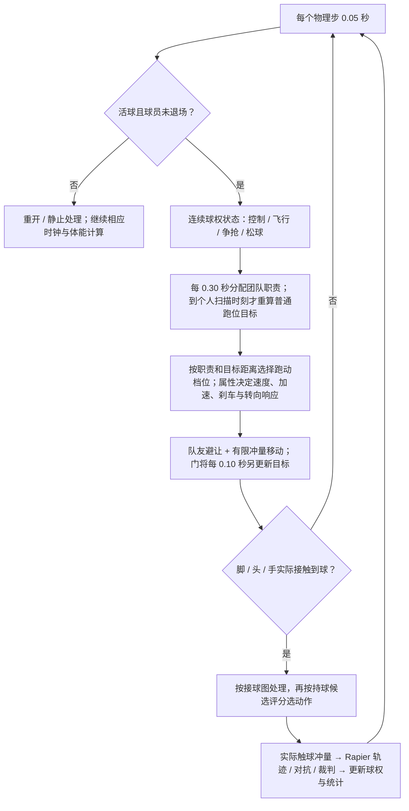
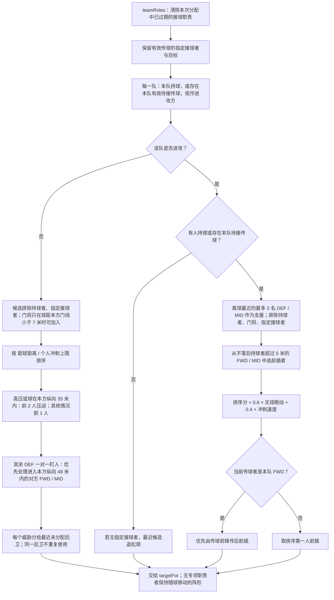
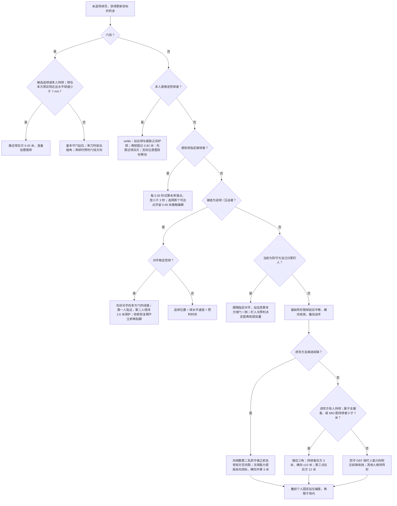
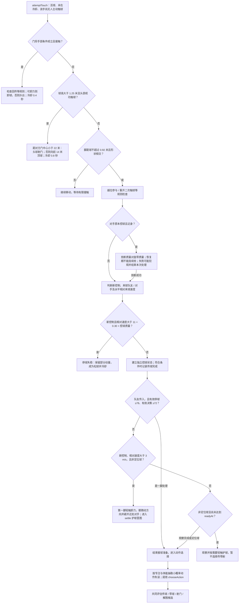
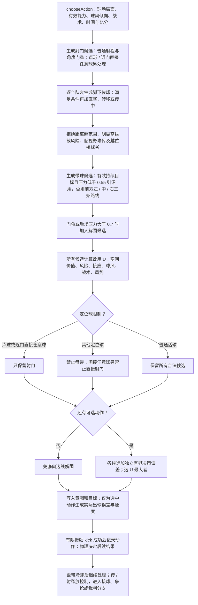
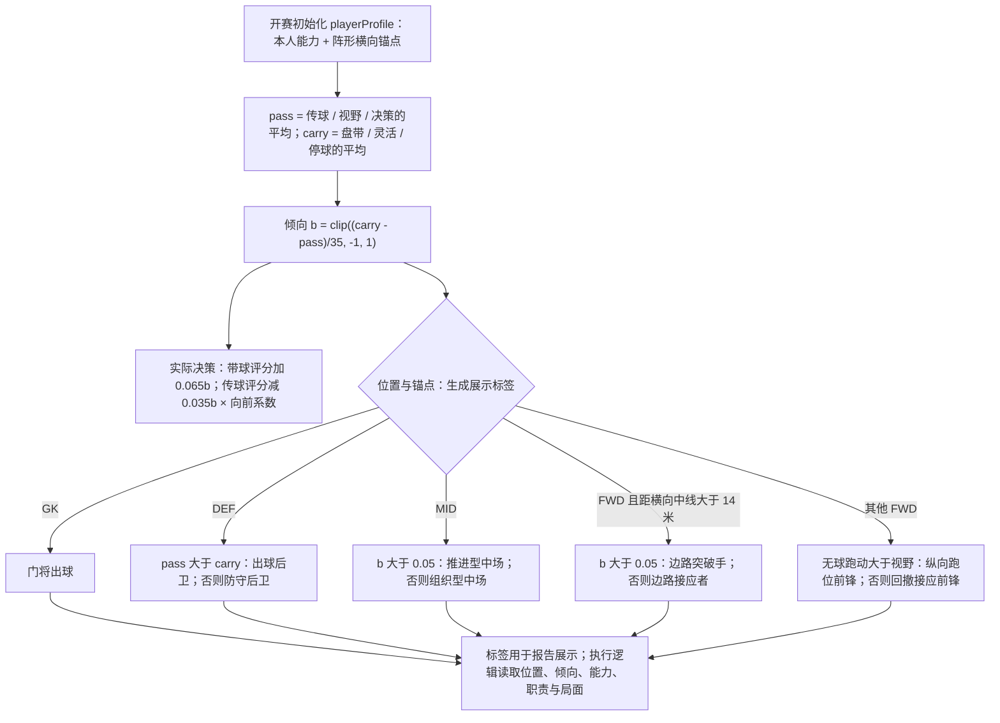

# 球员无球跑动与接球决策图（当前实现）

基线：`0.6.1-physical-motion` / `physical-motion-1`，代码提交 `00e683dc90aed61dd647144c5665d02f2cc6b45b`；核对日期：2026-10-17。本文描述正在执行的算法，供调整数据、战术及比赛代码时参考。图中的“估计成功率”用于选择动作，传球成功、夺球及进球仍由后续接触、物理与规则处理决定。

阅读顺序：总览 → 无球职责 → 跑位优先级 → 接球处理 → 持球候选评分 → 球风区别。GitHub 可直接显示 Mermaid 图；[总览 SVG](decision-map/01-overview.svg)、[无球职责 SVG](decision-map/02-roles.svg)、[跑位 SVG](decision-map/03-positioning.svg)、[接球 SVG](decision-map/04-reception.svg)、[持球决策 SVG](decision-map/05-actions.svg)、[球风 SVG](decision-map/06-profiles.svg)供放大查看。SVG 是本文 Mermaid 的导出副本，重新导出方法见[导出说明](decision-map/README.md)。

## 1. 总览与更新节奏



普通球员扫描间隔 `0.1 + (100 - (专注 + 决策)/2)/180` 秒；仅在 0.30 秒团队更新点检查是否到期，因此不是每步都重新规划。门将反应 `0.12 + (100 - 反应)/600` 秒，另有每 0.10 秒的目标更新。有限接触子步也会尝试触球；同一物理步最多发生一次主动处理。播放倍率不参与这些时间计算。

来源：[simulation.mjs](../simulation.mjs) 的 `createMatchSimulation / attemptTouch`、[continuity.mjs](../continuity.mjs)。

## 2. 无球职责如何分配

此图对双方分别执行；职责可能重叠，最终执行顺序见下一图。正式传球的接球职责有效期为 `传出时刻 + 预计飞行时间 + 1.8 秒`；缺少明确有效期时，`teamRoles` 才使用 `传出时刻 + 3.5 秒`。解围可以没有指定接球者。



注意：当前 `attack` 的定义已经包含“持球或本队待接传球”，因此图中“进攻方但两者都无”的松球兜底分支在正常输入下不会触发；失去有效球权后通常进入非进攻方追球分支。`support`、`runnerId` 只是选择结果，不保证执行，接球和压迫等优先分支可覆盖它们。

来源：[positioning.mjs](../positioning.mjs) 的 `teamRoles`。追球排序使用距离和冲刺上限，尚未把加速度、转身或视线遮挡纳入这一步的到达时间。

## 3. 跑位目标按什么顺序执行

以下是 `targetFor` 的真实优先级；遇到前面返回的分支，不再执行后面的分支。



各叶节点返回目标后，都进入下面的统一跑动档位与有限加减速计算；图中省略重复返回线，便于逐个查看优先分支。

角色与参数的实际区别：

| 分工 | 当前实现 | 影响属性 |
| --- | --- | --- |
| GK 门将 | 基准纵向 5 米；守门、慢球前出、单刀缩角；手部接球独立处理 | 反应、单刀处理、预判、制空、手型；出球时用出球能力 |
| DEF 后卫 | 基准纵向 27 米；可被选压迫、盯人或后场接应；本方纵向 35 米内盘带评分减 0.06 | 盯人、防守站位、预判、团队配合、抢断及身体能力 |
| MID 中场 | 基准纵向 49 米；可接应或前插；靠持球者小于 7 米也可进入三角接应 | 无球跑动、视野、传球、盘带、决策、团队配合 |
| FWD 前锋 | 基准纵向 70 米；参与前插排序；传球前锋优先传后前插；射门评分加 0.02 | 无球跑动、冲刺、终结、远射、决策；仍共同评估传带射 |
| 指定接球者 | 优先于追球、支援和前插，预测减速后的球路与本人可达范围 | 冲刺、爆发、平衡影响可达；停球能力影响接到后的处理 |
| 第一压迫 / 第二保护 | 第一人按距离与恢复状态贴近至约 1.5 / 0.35 米；第二人约 2.6 米 | 预判提前量；抢断与盘带质量决定近身夺球概率 |

阵形同位置横向锚点按首发顺序均分：`z = 8 + (组内序号 + 0.5)/同位置人数 × 52`。当前没有独立的边后卫、后腰、伪九号等可配置职责。

新建球队默认使用 `4-4-2 / balanced / normal`；选择 `4-3-3` 或 `3-5-2` 改变各位置人数及横向锚点。首发顺序也会影响同位置球员的横向锚点，进而影响前锋是否被标为边路球风。输入来源为球队保存的 `lineup / tactics` 与每名球员的 `role / attributes / fitness / personality / wellbeing / preferredFoot / weakFoot / heightCm`；不存在额外的隐藏球风枚举开关。

基础纵向目标：`x = 锚点x + (本方视角球x - 52.5) × 0.43 + (进攻 ? 7 : -7)`。反击再加进攻 `+3` / 防守 `-6`；高压防守 `+4`，低压防守 `-4`。边路战术把相对中线的阵形宽度乘 `1.25`。这些修正位于门将、接球、追球及指定盯人的提前返回分支之后，因此不是所有球员都同时得到这些平移。

几个专项目标的数学区别：追松球的提前时间 `0.12 + 0.003a(预判)` 秒；指定盯人的提前时间 `0.1 + 0.002a(预判)` 秒，站在对手靠本方球门一侧 `1.1 + 0.006(100 - a(盯人))` 米。前插纵向目标为 `max(基础x, min(倒数第二防守者x - 0.6, 球x + 12 + 0.06a(无球跑动)))`。门将一般前出深度 `clip(距本方门线 × 0.065, 1, 5)` 米；对手在门前 26 米内控球且附近没有队友保护时，改为 `clip(距门线 × (0.25 + 0.003a(单刀处理)), 2, 8)` 米。

只有未提前返回的阵形/前插/支援目标会叠加固定个人偏差：`accuracy = (100 - (a(进攻时无球跑动，否则防守站位) + a(团队配合))/2)/40`，防守时再乘 `1 - a(本队门将指挥)/1000`。横纵目标各加 `bias × accuracy`，其中 `bias` 是开赛固定的 `[-1,1)` 种子随机值，不是每步抖动。指定接球、压迫及一对一盯人的提前返回目标不使用该偏差。

接球可达计算：`turn = max(0, -当前速度在目标方向的投影)/刹车`，`available = max(0, t - turn - 0.08)`；`reach = min(正常跑速度 × available, max(0, 投影) × available + 0.5 × 爆发加速度 × available²)`。距离不大于 `reach + 0.65` 即认为可达。低球使用 `groundTravel`，高球使用空阻水平近似；未完整求解未来球高。

跑动档位按下表从上到下首次命中：

| 条件 | 档位 |
| --- | --- |
| 距目标小于 1.2 米 | 步行 |
| 本人控球 | 带球 |
| 指定接球者 | 距球大于 5 米冲刺，否则正常跑 |
| 追球者 | 距球大于 7 米冲刺，否则正常跑 |
| 被选前插者 | 冲刺 |
| 其他球员 | 距目标大于 18 米正常跑，否则慢跑 |

速度单位 m/s，`a(key)` 为有效属性：步行 `1.5`；慢跑 `2.7 + 0.014a(冲刺)`；正常跑 `4.3 + 0.022a(冲刺)`；冲刺 `5.7 + 0.036a(冲刺)`；带球为冲刺上限乘 `0.6 + 0.002a(盘带)`。实际向量再按档位限速；加速度、灵活响应与刹车经 `driveMovement` 有限冲量执行，详见 [PHYSICAL_MOTION_V061.md](PHYSICAL_MOTION_V061.md)。

来源：[positioning.mjs](../positioning.mjs) 的 `formation / targetFor`、[locomotion.mjs](../locomotion.mjs)、[ball-motion.mjs](../ball-motion.mjs)。

## 4. 接球后先处理什么

“接到球就立即选择传带射”不适用于所有接触。手部、头球、抢断、第一脚卸力及观察等待位于普通持球决策之前。



新控制时设置 `readyAt = 当前时刻 + 0.65 + (100 - 有效决策) × 0.012` 秒。高水平一脚处理与定位球可以绕过等待；它不是保证传球成功或保证每次都选择传球。

第一脚质量通常为 `0.65停球 + 0.20平衡 + 0.15灵活` 经逆足、压迫修正后的值；直接从对手脚下夺球时控球质量使用 `0.65抢断 + 0.35停球`。抢断成功估计为 `clamp(sigmoid((抢断动作质量 - 对手盘带动作质量)/18), 0.02, 0.98)`。

观察前的新接球轻触冷却 `0.14 + 0.18 × (1 - 控球质量/100)` 秒；来球过快后的冷却 `0.35 + (100 - 有效平衡)/200` 秒。轻触护球后冷却 `0.2` 秒。门将手部接触与头球各有独立有限体积；头球当前采用距离分支，未进入普通传带射候选评分。

来源：[simulation.mjs](../simulation.mjs) 的 `attemptTouch`、[receiving.mjs](../receiving.mjs) 的 `firstTouchVelocity`、[rules.mjs](../rules.mjs)、[physics.mjs](../physics.mjs) 的 `touchesBall / kick`。

## 5. 持球后如何选传、带、射

候选共同评分。图中的射门、传球和带球属于并列候选生成步骤，先生成射门候选不表示“能射必射”。



### 候选成立条件

| 动作 | 生成与过滤条件 |
| --- | --- |
| 普通射门 | 非门将；距门中心不大于 `17 + 0.14a(远射)` 米；距纵向中线不大于 20 米。大于 16 米开始混合远射质量，24 米起完全使用远射质量 |
| 直接定位球射门 | 点球；或直接任意球距门小于 30 米、横向距中线小于 20 米。之后只保留射门候选 |
| 脚下传球 | 球到队友距离在 `[3, 18 + 0.45a(视野)]` 米；根据队友当前速度预判目标 |
| 直塞 | 不属于传中；队友在前方超过 2 米、不是门将，且距离大于 9 米；额外提前量受接球者加速度和飞行时间约束 |
| 长传转移 | 不属于传中；距离大于 26 米，且为反击战术或双方横向间隔大于 24 米 |
| 传中 | 角球；或边路战术下持球点距中线大于 19 米、本方视角纵向大于 68 米，队友距中线小于 17 米。它替代该队友的普通脚下候选，不额外同时生成该队友直塞 / 转移 |
| 传球拒绝条件 | 拦截风险大于 0.88 且压力小于 0.7；非最近队友、视野小于 45、距离大于 25 米且风险大于 0.3；或接球者越过中线、球与倒数第二防守者构成的越位线 |
| 带球 | 非门将且非定位球；左右与直行路线评估防守走廊。有效 carry 意图且压力小于 0.55 时仅复用该目的地 |
| 解围 | 门将总有该候选；其他人在本方纵向小于 30 米且压力大于 0.7 时加入。仍与其他动作评分竞争 |

### 效用数学与参数

以下符号：`clip` 为截断，`a` 为有效能力，`Q` 为动作质量，`b` 为球风倾向，`d` 为向前传球距离，`P` 为贴身压力；`V0` 为当前球位置价值，`Vt` 为目标位置价值。

```text
x = clip(本方视角纵向位置 / 105, 0, 1)
c = 1 - clip(abs(z - 34) / 34, 0, 1)
V = 0.015 + 0.04x + 0.20x^4 × (0.45 + 0.55c)

传球精度 A = clip(0.88 + 0.001(Q - 50) - 0.002max(0, 距离 - 15), 0.55, 0.98)
传球估计成功 s = (1 - 拦截风险) × A
摆脱收益 E = 0.14P × clip(接球点距最近对手距离 / 7, 0, 1)
接应收益 R = 0.02s + 0.004min(3, 接球点周围 5–23 米内的其他队友数)
             + 0.012min(1, 本次连续控球秒数)
U传 = sVt - V0 - (1-s)(0.07 + 0.30V0) + E + R + T
       - 0.035b × clip(d/10, 0.3, 1) + B × sign(d)

带球走廊危险 D = clip((2.6 - 路线到最近对手的距离) / 2.6, 0, 1)
带球估计成功 s = clip(0.95 - D(1.05 - 0.005Q), 0.15, 0.98)
U带 = sVt - V0 - (1-s)(0.09 + 0.40V0) + 0.065b
       + 0.025clip((走廊距离 - 3)/5, 0, 1)
       + (复用持续意图 ? 0.025 : 0)
       - (DEF 且本方纵向小于 35 米 ? 0.06 : 0)
       - 0.03clip((3 - min(终点z, 68 - 终点z))/3, 0, 1) + B

U射 = xG(0.65 + Q/100) - 0.30V0 - 0.025(1-xG) + (FWD ? 0.02 : 0) + B
U解围 = 0.17P - 0.07；无候选时的兜底解围 U=0

T = 控球战术时 0.04s；反击战术时 0.04clip(d/25,-1,1)；
    其他情况若为传中则 0.04，否则 0；最终 clip(T,-0.04,0.04)
B = 70 分钟起且落后时 0.02 × (进取心 - 50)/50，否则 0
ε = 0.006 + 0.045(1 - a(决策)/100)
最终动作 = argmax(U + 均匀随机[-ε, ε])
```

`T` 以代码中的控球 → 反击 → 传中顺序取一项，不累加。低决策增加选择偏差，不是固定增加射门或盘带次数；高球风盘带倾向可以被线路风险、压力与更好的射门机会覆盖。

拦截估计对每名对手比较：球到走廊投影点时间 `arrival = 投影比例 × 飞行时间`；对手可达时间 `reach = max(0, 离走廊距离 - 0.55)/正常跑速度 + 0.14 + (100 - 预判)/500`。高球投影高度超过 2.4 米时忽略该对手；普通地面球若走廊距离小于 0.7 米且到达时间大于 0.14 秒，威胁取 0.98，否则 `clip((arrival + 0.25 - reach)/0.55, 0, 0.94)`；总风险 `1 - ∏(1 - 单人威胁)`。这是决策近似，不是实际拦截抽签。

普通射门的机会质量：`xG = clip(sigmoid(-2.1 - 0.09(距门-12) + 1.8(可见门角-0.35) - 0.8封堵 + 2.5门将偏位), 0.005, 0.8)`；点球固定机会值 0.76。个人射术进入 `Q`、效用及实际瞄准误差，不把球员终结能力直接写入机会 xG。

`Q = clip(基础动作混合值 × 惯用脚系数 - 10P(1 - 镇定/100) - (专注失误 ? 12 : 0), 1, 100)`。传球基础 `0.8传球 + 0.2平衡`；盘带 `0.65盘带 + 0.2灵活 + 0.15平衡`；传中 `0.8传中 + 0.2传球`；门将出球 `0.75出球 + 0.25传球`。普通逆足系数 `1 - 0.18(1 - 逆足/100)`，双足球员系数 `0.95 + 0.05逆足/100`。专注失误概率 `clip(0.0015 × exp((50 - 专注)/30) × (1 + 0.8(1 - 体能/100)), 0.0002, 0.012)`。

带球意图有效期为 `当前时刻 + 1.6 + 0.01a(决策)` 秒，其他普通意图为 `当前时刻 + 1.8` 秒。每次有资格触球仍调用 `chooseAction`；持续意图仅复用路线并加分，不是该时段完全禁止传球。盘带触球冷却 `0.22 + 0.16(1 - a(盘带)/100)` 秒，其他选中动作冷却 `0.28` 秒。实际初速、草阻与空气阻力采用 0.6.1 参数，不采用旧 v2 文档速度。

来源：[decisions.mjs](../decisions.mjs) 的 `chooseAction / shotCandidate / interceptionRisk`、[skills.mjs](../skills.mjs)、[spatial.mjs](../spatial.mjs)、[ball-motion.mjs](../ball-motion.mjs)。

## 6. 不同球风到底差在哪里



`playerProfile` 当前在开赛时用尚无 `matchState` 的长期球员生成并缓存，所以初始 `b` 基于长期能力，不按开赛体能再折减；之后也不会每次随赛内体能或心理变化重算。动作质量及跑速仍使用实时有效属性。标签本身没有专属决策树，“回撤接应前锋”不会单凭标签触发独立回撤；“防守后卫”也不是一律禁止带球。

例如组织者的 `pass=80、carry=45` 得到 `b=-1`，仅球风项让带球效用减 `0.065`、向前传球效用最多加 `0.035`；推进者的 `pass=45、carry=80` 得到 `b=1`，这两项相反。最终选择还要比较动作质量、球场位置、压力与风险，不能从标签直接推断传球次数。

阵形也会改变展示结果：4-4-2 与 3-5-2 的两名前锋锚点为 `z=21、47`，距中线均为 13 米，不进入“边路”标签分支；4-3-3 的三名前锋约为 `z=16.67、34、51.33`，两侧前锋进入边路分支。MID 即使位于边路，也先进入中场标签分支。

| 差异来源 | 实际效果 | 边界 |
| --- | --- | --- |
| 组织倾向 `b < 0` | 相对提高传球、降低盘带评分 | 不是保证短传；风险与空间仍参与 |
| 推进倾向 `b > 0` | 相对提高盘带、降低传球评分 | 不直接增加跑速；跑速由冲刺等能力计算 |
| 无球跑动与冲刺高 | 更容易在前插排序中胜出，目标可更靠前 | 指定接球、压迫等更高优先职责仍可覆盖 |
| 视野高 | 可考虑更远的队友；直塞提前量上限增加 | 不是视觉传感器或真实视野遮挡模拟 |
| 控球战术 possession | 提高估计更安全的传球评分 | 不额外给所有球员贴“组织者”标签 |
| 反击 counter | 阵形进攻更靠前、防守更深；向前传球加分，可生成远距离转移 | 无持球距离、线路与越位门槛的豁免 |
| 边路 wide | 阵形拉宽，满足区域条件时生成传中 | “边路突破手”标签本身不启用此战术 |
| 均衡 balanced | 使用基础阵形与评分；传中条件仍可由角球触发 | 无额外均衡加分 |
| 高 / 中 / 低压迫 | 改追球人数、基础防线平移及体能消耗 | 球在本方纵向 35 米内时，低压也可选 2 人追球 |
| 进取心 | 70 分钟起且落后时，给射门、盘带与向前传球小幅修正 | 忠诚、社交意愿未直接进入此动作评分 |
| 心理与性格 | 士气、信心、适应影响镇定/决策；领导力和抗挫影响冲击，情绪稳定影响抗议 | 年龄、国籍和公众标签未直接分支跑位或传带射；年龄可通过成长后的能力间接影响 |

体能对身体有效属性乘 `0.7 + 0.3√(体能/100)`，对技术属性乘 `0.88 + 0.12体能/100`；镇定与决策叠加心理修正 `clip(2(士气-50)/50 + 1.5(信心-50)/50 - 4(1-适应/100), -4, 3)`。耐力和压迫通过体能消耗间接影响之后的执行。

## 7. 当前实现限制与修改提醒

- 接球优先于前插；同一球员可能同时被选为接球者和前插者，因此不能只看 `runnerId` 解释实际跑动。支援只有存在持球者时才执行三角目标，飞行阶段可能回到普通进攻阵形。
- `teamRoles` 的接球过期只影响这次职责分配，不会直接删除 simulation 持有的 `pendingPass`；接球完成统计另有 10 秒条件。修改时需同时核对职责、球权与统计，不能把三个时限当成一个。
- 前插目标 `max(基础目标, min(防线-0.6, 球前方目标))` 没有把所有基础目标硬限制在越位线前；真正传球候选和裁判另检查越位，不能声称“前插永不越位”。
- `settle` 写有 `expiresAt`，但持球跑位分支没有单独检查它是否过期；后续处理通常会替换意图。图据实保留此行为，没有在本次文档任务里修复算法。
- 目前没有角色专属学习、完整视线遮挡、身体朝向认知、主动假跑、队友默契或复杂战术职责编辑器。`phase` 的 buildup / midfield / finalThird 标签未驱动独立阶段决策树。
- 修改阈值与能力时先区分“选择更倾向什么”和“选中后能否执行”；估计成功率不等于强制成功，回放仍读取保存轨迹。

## 8. 同步维护约定（用户本次明确要求）

1. 修改下表任一相关算法、固定参数、默认数据或属性含义时，在同一次改动中立即更新对应图、条件表、数学式与本节核对记录；拓扑没变也要更新发生变化的阈值和解释。日常训练/比赛导致的单个存档能力变化由参数化公式表达，无需为每个存档复制一套图。
2. Mermaid 是图的可编辑来源；同步重新导出 `decision-map/*.svg`。本次导出使用 Mermaid CLI 12.0.0、Dagre 布局和微软雅黑字体配置；工具不作为游戏运行依赖。更新导出工具版本时记录新版本，不增加 CI 或钩子。
3. 保持链接、代码函数对应和 `SOURCE_SNAPSHOT.json` 文件摘要同步。摘要只帮助定位文档是否基于当前代码，不能代替内容审查，也未加入强制检查阶段。
4. 调整球风必须明确哪些名称只是展示、哪些字段真正改变评分/职责；新增未实现设计另写提案，不能画入当前实现图。
5. 更新本模块 CHANGELOG、必要的 README 和仓库入口；算法变化照常更新引擎版本与兼容说明。历史轨迹不重算。原有分支、检查、PR、备份与部署要求见根AGENTS；本次归档另获明确的单次纯文档验证例外，CI配置不改，不代表批准先前的开发提速方案或以后的通用检查豁免。

| 改动位置 | 必须核对的章节 / 图 |
| --- | --- |
| positioning.mjs | 2 无球职责、3 跑位、6 分工区别、7 限制 |
| locomotion.mjs、physics.mjs、ball-motion.mjs | 1 节奏、3 可达/速度、4 有限触球、5 执行速度与拦截估计 |
| simulation.mjs、continuity.mjs、receiving.mjs、goalkeeping.mjs | 1 总览、2 职责时限、3 门将、4 接球、5 决策调用与冷却 |
| decisions.mjs、skills.mjs、spatial.mjs | 5 候选/评分、6 球风与数据作用 |
| players/index.mjs、players/match-state.mjs、players/catalog.mjs | 3 属性影响、4 控球能力、5 Q、6 有效属性与个性 |
| tactics/index.mjs、rules.mjs | 2 压迫、3 阵形、4 规则前置、5 定位球/越位、6 战术区别 |
| world/index.mjs 中球队默认战术及球员生成参数 | 3 初始阵形与输入、6 球风/能力分布；仅相关默认数据变动需要修改本图 |

初次归档：2026-10-17，仅新增参考图、导出副本、代码摘要和维护入口；游戏代码、数值、比赛规则、数据库、检查命令及CI配置均未改变。本次提交/合并验证的单次例外详见根AGENTS。
