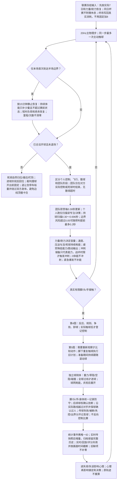
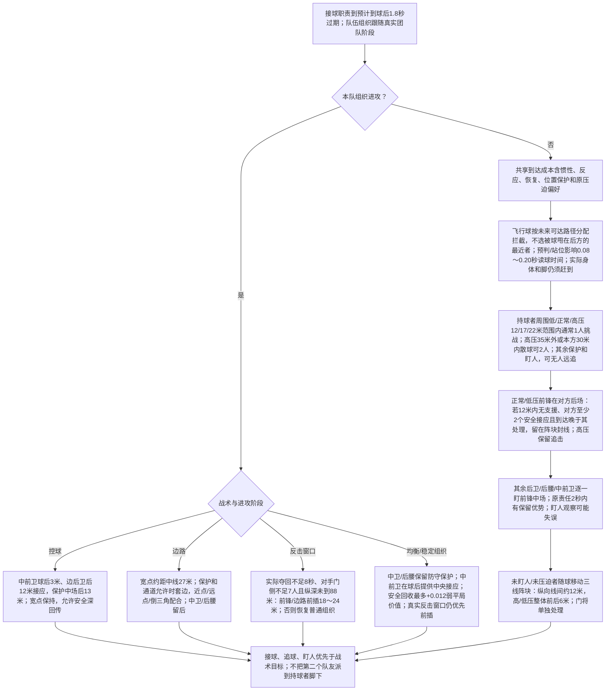
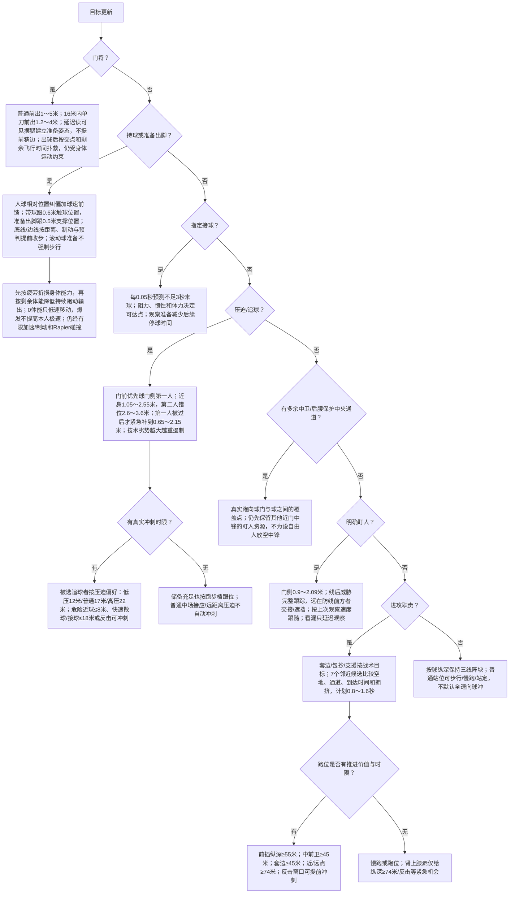
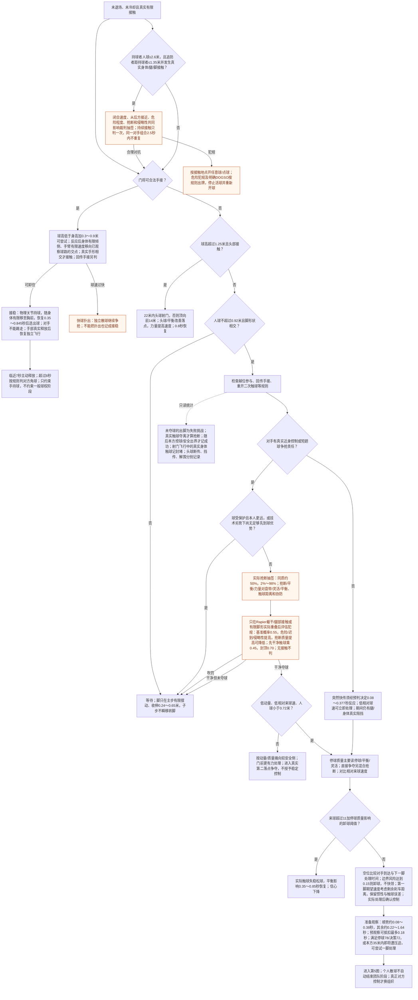
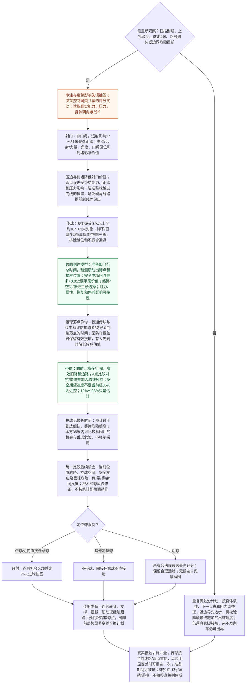
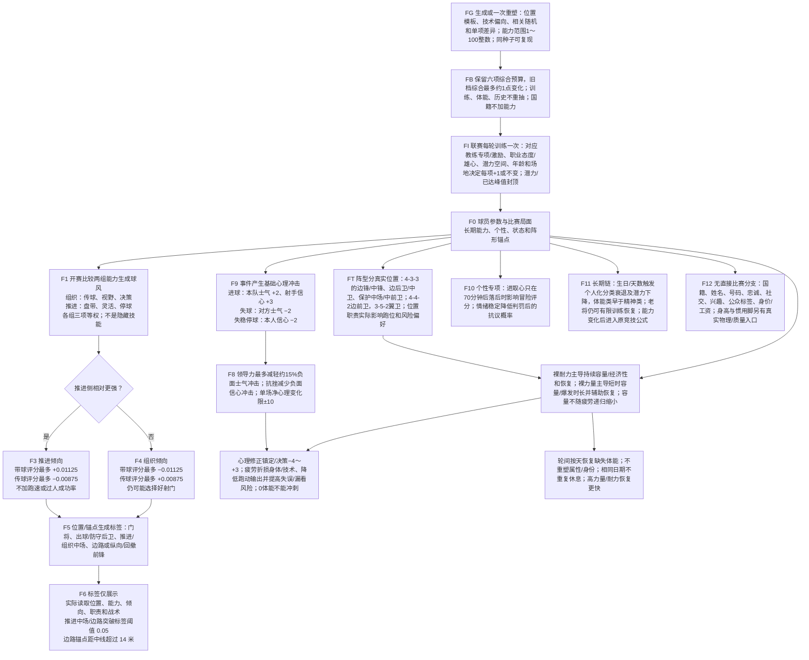
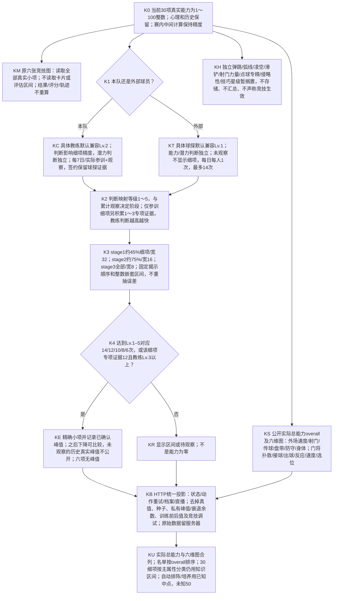

# 球员决策树：触发数值、概率与属性实战效果

0.30.1另提供[首发球队均分](../ratings/TEAM_RATING_V0301.md)：只对本场11名首发的已保存个人评分做算术平均，不回写个人评分，不参与球员决策或物理；七张决策图/SVG分支保持，ratings入口源码摘要随只读汇总更新。

当前实现引擎`0.39.0-shot-plane-aim` / `shot-plane-aim-1`。射门落点瞄准整球实际越过门线的位置，角度不再把门线交点系统性推向射手一侧；终结/远射能力、压力、球门角度和门将站位继续影响质量与结果。固定八场修复前后对照见[射门门线瞄准](SHOT_AIM_V0390.md)。不改射门候选、决策偏好或动作配额。0.38普通传球和传中候选继续使用接球者/防守者到达落点的时间竞速；传球质量控制目标散布与执行估计，视野决定可用对象与直塞，决策控制扫描和出脚前重评灵敏度。细节见[传球落点设计](PASS_RECEPTION_V0380.md)。历史比赛不重算。

绿色是候选成功**估计**，橙色是实际随机**抽签**，其余是条件、价值修正或物理执行。估计80%不等于系统抽签直接判传球成功；进球仍须实际球越线。下文列相关性、因素和触发参数，具体公式只放专项数学文档。

阅读：[总览SVG](decision-map/01-overview.svg)、[职责SVG](decision-map/02-roles.svg)、[跑位SVG](decision-map/03-positioning.svg)、[接球SVG](decision-map/04-reception.svg)、[动作SVG](decision-map/05-actions.svg)、[球风SVG](decision-map/06-profiles.svg)、[知识SVG](decision-map/07-knowledge.svg)。Mermaid是可编辑来源，SVG同步导出。

## 1. 总览：感知、选择、执行和统计分开

| 环节     | 触发与因素                                                                                                                              | 实战效果与边界                                          |
| -------- | --------------------------------------------------------------------------------------------------------------------------------------- | ------------------------------------------------------- |
| 个人控制 | 脚触球体积半径0.18米，腿收伸0.24～0.65米、最快2m/s；球低于1.3米；近控半径2.6米/相对速度3.5m/s，快带4.2米/4.5m/s；旧意图有0.75秒恢复判定 | 无控制时不能远程触球；实际脚触仍需人球≤0.92米且形状相交 |
| 近身争抢 | 原持球者低球、距球≤2.6米、相对球速<5.5m/s，可保留1.1秒挑战责任                                                                          | 仅用于区分近身对抗，不是保底控球或团队阶段上限          |
| 有效能力 | 真实30小项1～100；疲劳分别影响身体/技术；心理修正镇定/决策−4～+3                                                                        | 公开概览、球探区间不代替真实数值；身份不制造隐藏加成    |
| 持续体能 | 当前消耗基准系数0.64；速度非线性增加负荷，低/普通/高压为0.85/1/1.2，门将为外场45%，死球为活球20%；力量/耐力改变容量与经济性 | 疲劳降低有效身体/技术能力和持续跑动；低速才恢复；储备不自动触发冲刺，见第3图；0体能禁冲刺；关键爆发消耗储备/债务，不补充体能或提高速度 |
| 两类随机 | 专注失误每次新决策抽签0.02%～1.2%；同类动作共享评分扰动约±0.006～±0.051                                                                 | 决策高减少评分误差；同一计划的每脚带球不重抽选择        |
| 球       | 地面计划初速≤30m/s、主动触球≤38m/s，沿原草阻/空阻连续减速                                                                               | 属物理保护，不限制全场统计；5×只属于播放时钟            |
| 重开     | 最低准备12～25秒随类型；须实际就位；退让目标加0.5米裕量                                                                                 | 进球先保留15比赛秒，再中圈准备；正式出脚才放开重开状态  |

来源：`simulation.mjs`、`onball.mjs`、`continuity.mjs`、`physics.mjs`、`activity.mjs`。

## 2. 无球职责：阵块、压迫、盯人、接应与前插

| 因素     | 当前影响                                                                              |
| -------- | ------------------------------------------------------------------------------------- |
| 真实位置 | 4-3-3区分中卫/边卫、后腰/中前卫、边锋/中锋；4-4-2边前卫、3-5-2翼卫；不是额外能力      |
| 防守分工 | 中卫远离门区上抢、前锋深回收有成本；负荷高和恢复期不抢占每次追球；原压迫偏好1.2秒     |
| 盯人     | 盯人/站位影响分配，旧责任有1.2秒成本优势；一人一防；对方无球/灵活可扰乱观察           |
| 中场接应 | 建构/中场相位安全传给中前卫或后腰，选择价值最多+0.012，作为弱平局偏好；实际反击窗口/前场相位不加，不设传球配额 |
| 控球     | 安全传递评分最多+0.015，带球目标纵深85%；取消深回传额外扣分，不改变球速               |
| 边路     | 空闲宽点分球/可行传中最多各+0.0225；宽路带球最多+0.01375；须有真实通道和接应          |
| 反击     | 窗口内向前传最多+0.0225、带球距离120%；窗口外向前最多+0.00375；队内传球不刷新夺回时间 |

来源：`positioning.mjs`、`defending.mjs`、`tactical-plan.mjs`、tactics公共位置/预设。

## 3. 跑位：身体必须跟上球和计划

| 部分         | 属性与数值的作用                                                                                                                                                            |
| ------------ | --------------------------------------------------------------------------------------------------------------------------------------------------------------------------- |
| 人体运动     | 新鲜冲刺约5.7～9.3m/s，加速/响应/制动读有效身体属性；疲劳再降低持续跑动输出，0体能只能低速移动；站定0、步行1.5m/s，真实惯性不瞬间归零                                       |
| 带球档位     | 近控为本人极速的60.2%～80%，快带86.1%～96%；盘带提高可控跑速；恢复期取消持续快带                                                                                            |
| 出脚准备     | 滚动球速度高时跟跑/冲刺，慢球走近支撑，静止球才停车；身体和球各自独立                                                                                                       |
| 体能         | 裸力量/耐力决定容量、消耗和各类恢复；身体/技术随疲劳折损，持续跑动输出另外下降；短时负荷决定是否还能冲刺，但不主动要求球员冲刺；爆发约0.9～2.5秒并随剩余体能缩短，透支债务恢复后可再用，不补能/不超速 |
| 冲刺意图     | 高压压迫者22米、普通17米、低压12米内可执行压迫冲刺；危险球8米内、快速散球/接球18米内；追球人有明确抢点时限才冲刺 | 高压也须近球才可透支爆发；普通争球不能触发肾上腺素；紧急门前覆盖可匹配被盯目标跑速 |
| 前插与套边   | 单一前插者纵深55米后、中央中场45米后、套边45米后可冲刺；反击窗口提前 | 近点/远点要到74米；条件不满足时慢跑，不因选中战术职责自动全速跑 |
| 盯人观察     | 盯人/预判/专注决定约0.16～0.56秒扫描；旧观察最多外推0.9秒；对手急变向或球大转移时才检查失误                                                                                 |
| 盯人失误抽签 | 对方跑速>2m/s且变速>1.8m/s或球转移>7米，至少2.5秒一次资格；无球/灵活对抗盯人/预判/专注及疲劳，0.3%～7%，延迟0.35～0.944秒                                                   |
| 接应         | 无球/决策改善选点，团队配合影响位置精度；清晰位置职责不被通用支援覆盖                                                                                                       |

来源：`locomotion.mjs`、`onball.mjs`、`arrival.mjs`、`offball.mjs`、`positioning.mjs`、`execution.mjs`。0.36.0把“体能储备是否允许”和“战术是否要求冲刺”分开；完整校准与残余偏差见[SITUATIONAL_SPRINT_V0360.md](SITUATIONAL_SPRINT_V0360.md)。

## 4. 接球与对抗：触碰不等于稳定夺得球权

| 环节         | 主要因素与边界                                                                                                                 |
| ------------ | ------------------------------------------------------------------------------------------------------------------------------ |
| 突然快传反应 | 预判越高越快；相对速度≤3～6m/s（随停球）可立即处理；只是故意卸球反应，不让球穿过身体                                           |
| 抢断窗口     | 球距原持球者<0.72米且防守者更远时多围堵；判断受决策影响；不是每次站在旁边都抽签                                                |
| 对抗抽签     | 技术质量、触球距离优势、最多2名协防共同作用；无球时的身体接触不自动算抢断                                                      |
| 抢断后处理   | 身体相对速度<2.5m/s、来球相对速度<3～5m/s（停球影响）、人球<0.72米才能直接卸球；其余先捅球再争落点；抢断胜出不等于稳定夺得球权 |
| 犯规与牌     | 除近身抢断外，持球者真实身体接触也交由裁判判断；普通并肩碰撞风险低，闭合速度、从后方接近、危险程度、抢断质量和侵略性改变结果；无接触不判 |
| 身体接触判罚 | 持球者控制球距人≤2.6米；防守者与其相距≤1.35米且Rapier躯干/腿部或有限脚形真实接触；持续接触只判一次，同组2.5秒冷却；接触风险权重0.04–0.92，再与0.55裁判基准、危险/侵略性及抢断质量共同作用；最终判罚仍封顶0.70 |
| 犯规与牌概率 | 危险等级按相对闭合速度评估；身体接触中不把“防守者离球更远”误当迟到，故不因此自动升级黄牌；危险接触及明确DOGSO才进入黄/红牌条件；不是全场犯规/牌配额 |
| 抢断犯规概率 | 只在Rapier躯干/腿部真实碰撞或有限脚形与对手实际重叠时使用0.55基准；迟到/危险/侵略性增加、抢断质量影响降低；先干净触球乘0.45，概率封顶0.70；这不是全场犯规率配额 |
| 控制登记     | 实际脚触卸球或实际传射后才确认；准备摆腿、瞬间擦碰和最后触球者不能替代稳定控制                                                 |
| 门将/头球    | 门将有独立反应/卸力/扑挡；头球质量受头球75%和平衡25%，力量决定速度；普通接球不算扑救                                           |

门将细节：预判影响0.08～0.278秒观察；准备最多减0.12秒反应且不低于0.08秒，0.5秒后过期。手臂约2.53～5m/s，反射越高越快；单刀与身高影响有限倾侧伸展，手部半径0.35米不随能力变大。当前球速低于接球能力决定的约8～25m/s门槛可接稳；否则尝试扑向门柱外侧，接球影响实际抽样的方向误差及残余动能。持球须有真实手部约束，8秒规则只管手持球。

来源：`simulation.mjs`、`receiving.mjs`、`onball.mjs`、`defending.mjs`、`goalkeeping.mjs`、`rules.mjs`。

## 5. 持球：机会、安全、等待与持续执行

| 动作         | 触发数值、相关性与实战效果                                                                                                                                                               |
| ------------ | ---------------------------------------------------------------------------------------------------------------------------------------------------------------------------------------- |
| 动作扫描     | 决策1～100对应约0.696～0.30秒；球走>4米、近处防守逼近>0.8米且距球<2米、或路线剩<1米可提前；边界危险>0.05再随预判提前最多0.2秒；不是最低持球时间                                          |
| 质量         | 传球主要传球80%/平衡20%，停球65%/平衡20%/灵活15%，盘带65%/灵活20%/平衡15%；传球能力同时影响落点散布与执行估计；逆足、压力、镇定和失误再修正                                                                                  |
| 射门         | 远射20/50/80对应最远19.8/24/28.2米，横向距中线≤20米；16～24米由终结渐转远射；门将位置/线路/角度参与价值，实际入球由物理决定                                                              |
| 射门质量与落点 | 受压或线路易被封堵时，预期威胁价值降低；终结能力高、距离近、压力低时落点更集中，距离远/压力大/终结能力低时误差增加。目标位于球心完整越过门线的平面（门线外一个球半径加0.05米），近门柱斜角不会因瞄准门后深处而系统性向射手侧偏移；射正/进球仍由球体实际轨迹决定 |
| 传球对象     | 视野20/50/80对应最远27/40.5/54米；接应速度提前最多0.65秒；直塞需前方>2米且距离>9米，另受接球者爆发和时间限制                                                                             |
| 线路与接球   | 对手当前速度、加速、制动、预判、恢复进入沿线拦截风险；地面球用相同阻力反解时间；另比较接球者与防守者抵达落点的时间，预判高者更早进入防守可达估计；无法及时接应、停球差或防守者先到会降低可接性估计；建构/中场相位安全找中前卫或后腰接应，最高+0.012弱平局价值 |
| 传球风险过滤 | 风险>0.88且压力<0.7拒绝；非最近队友/视野<45/距离>25米/风险>0.3拒绝；传中风险>0.75拒绝；风险不是实际成功抽签                                                                              |
| 传中         | 纵深≥65米、离中线≥17米、接应纵深≥76米且离中线≤18米、间隔≥8米；83米后可倒三角；头球/力量或停球与防守争抢估计影响接应价值                                                                  |
| 带球路线     | 向前基础6～9.5米，横移±6/±3/0；另有横移5米、回撤3米横移3米；旧目标须仍有效；无强制只向前跑                                                                                               |
| 带球安全     | 24米内对手、4个路线点、共享到达/对抗、最多2名协防；另比较越线时间与预判/制动/下一脚触球，盘带高减少边界估计损失；安全速度不足当前档85%则近控；危险>0.15标突破；无过人或出界抽签          |
| 持续执行     | 触球间隔0.25～0.349秒随盘带；边界/路线终点提前收步读平衡/灵活的实际制动、预判反应及剩余距离，采用脚触实际可用的60%制动份额；最终脚触冲量再次按球的剩余刹停距离收速，开放区域不变，来不及刹车仍可出界 |
| 等待/保球    | 无1.2秒护球截止；预计上抢更快则等待代价更大；团队配合提高后续接应价值；空闲安全出口能胜过挤进人群，横向或回传不自动视为浪费机会                                                          |
| 战术/球风    | 控球更重安全传递，边路更重空闲宽点和真实传中，反击窗口重纵向；传带倾向来自两组真实技术；均为评分而非必选                                                                                 |
| 传球执行     | 传球主项占质量80%、平衡20%；能力越高目标散布越小，估算执行准确度随质量上升；较低传球值的球员落点更分散；球速由同一地面阻力模型解算，高传球不强行改变比赛次数或成功结果 |
| 传射准备     | 平衡、速度和力度决定摆腿，灵活/平衡/人速限制转身；预判0.10～0.30秒追踪接应；充分观察并侧身打开约90度可一脚传球；出脚前按实际线路及落点重估，估算成功率下降超过约4～12个百分点时重看一次（决策越高，触发越敏锐），只能再选一次并有短暂复核冷却；背对射门仍须转身 |
| 独立结果     | 脚/头/手与实际球相交后才踢；球不会因候选估计成功而吸到队友脚下；射门数量、比分、时长统计不反馈此树                                                                                       |

来源：`decisions.mjs`、`carrying.mjs`、`onball.mjs`、`execution.mjs`、`ball-motion.mjs`、`tactical-plan.mjs`、`opportunity.mjs`。数学细节见[控球模型](CONTROL_MODEL_V0270.md)。

### 0.30 动作统计边界（只读）

统计状态在20Hz物理观察中更新，所有增量有本场唯一ID，随原检查点恢复。有效触球按接球控制、头球/抢断等直接触球和主动传射动作统计；连续盘带中的步态脚触不逐次累加进常规触球，原始物理触点只保留为后台诊断。没有次数目标或新的结果抽签。身体碰撞只在新接触记录挡传；同次传球被折射后再捡到算回收，不再给第二个人补预判拦截。头球主动截断传球可记拦截；后场无指定接收者的头球和clearance动作记解围，不混入传球成功率。抢断尝试、真实夺离接触、后续夺回球权分别记录，未出脚的围堵不算失败抢断。

过人仅观察实际takeOn触球：对手须在路线前方至少0.5米、横向走廊1.8米内，进入1.8米实际争抢范围后才记尝试；沿原路线超过对手0.8米、与对手拉开1.8米、球沿路线推进至少1.5米，同时本人控制且人球距离不超过2.6米才记成功。持续触球不重复登记；12秒或分离超过7米关闭过期观察，不影响任何球员行为。意图、空地推进和无人接触的假动作不直接加过人数据。

丢球只在对方控制或交出重开权后确认：传球交出球权、被断、失控、带出界分别归因，同次只记一次；射门、正常解围、被犯规和本方重新控制不额外扣丢球。过人失败的同次被断只扣一次分，传球失败通过成功率评价。评分3采用按位置防守、成功过人与推进、封堵/解围、丢球类别和边际递减贡献；不从球员能力、身份或胜负直接加分。扑救从射门实际结果确认，稳定抱住球可立即确认，扑出仍待结果明确；门将介入后另有关键门线解围时归后卫封堵。完整口径和评分数学见[STATISTICS_V0300](STATISTICS_V0300.md)。

## 6. 球风、个性与全部球员数据的实战入口

0.27补充：团队配合进入后续接应价值；预判影响突然快传的可处理反应和准备时追踪。以下球风修正已缩放到统一机会价值尺度，仍不提供隐藏能力。

F3/F4球风倾向在开赛缓存，不随每次疲劳或心理波动重算；实际跑速、动作质量仍使用实时有效能力。组织组三项均值比推进组高35点时倾向达到组织端，反之达到推进端；评分是倾向修正而非概率。回传也会受到该球风传球修正，只是幅度较小。标签“回撤接应前锋”不会单独启用回撤算法，“防守后卫”不禁止带球，推进标签也不直接增加冲刺速度。

FG/FB是赛前数值分配，不是新的赛内抽签。服务器技术模板只解释数值来源（0.12.0不再直接披露给客户端），不给予隐藏加成；如速度突破型更偏盘带/灵活/传中，支点型更偏头球/力量，组织型更偏视野/停球，仍逐项经过第1～5图的实际能力与局面判断。旧档六项预算保持在0.1点误差内，最多约1点综合舍入变化；新增球员按位置预算随机生成。99号观察球员林曜只显式加入指定存档，终结98/无球98/决策96/盘带96，防守与门将能力仍低；没有强制进球、胜利或评分加成。来源：[profiles.mjs](../../players/profiles.mjs)、[球员公共接口](../../players/index.mjs)。

位置和战术仍有实际差别：前锋传后前插优先、射门评分加0.02；后卫后场带球视走廊危险减0.02～0.07并承担盯人；中场和后卫更常被选支援；门将使用手部、守门站位及出球逻辑。控球更偏安全传球，反击更偏向前和快速转移，边路拉宽并允许特定区域传中；高/中/低压迫改变追球人数、阵形与耗能。4-3-3两侧前锋锚点可进入边路标签，而4-4-2/3-5-2的两名前锋通常不会，仅标签不同不等于多出一套行为。

### 30项能力索引：提高这项数据到底改变什么

| 能力（代码键）         | 直接作用节点与影响方向                                                                                      | 不应推断的效果                                                                          |
| ---------------------- | ----------------------------------------------------------------------------------------------------------- | --------------------------------------------------------------------------------------- |
| 终结 `finishing`       | A1/A13近射质量、点球质量与主罚排序；越高目标散布越小                                                        | 不直接提高普通机会xG或固定进球率                                                        |
| 远射 `longShots`       | A1扩大可考虑射程，远距离射门更准；辅助定位球质量                                                            | 不保证更常远射，仍比较其他候选                                                          |
| 传球 `passing`         | A2/A4/A13普通传球质量、目标散布与估算准确度，辅助传中和门将出球；F1组织倾向；高传值在同线路下更容易把球送进接球队员可处理范围 | 不等于固定传成率；固定解围未应用质量散布；接球仍由防守争夺和真实触球决定 |
| 停球 `firstTouch`      | T15～T20控球门槛、轻触偏差、一脚处理资格；F1推进倾向                                                        | 不代替盘带与独立头球能力                                                                |
| 盘带 `dribbling`       | A5提升个人突破/保球估计与对抗质量；带球触球额外前送随盘带提高而减少，使球更易跟进；O5带球档速度；F1推进倾向 | 不直接提高无球冲刺上限，不按盘带数值直接判过人成功；不影响动作选择权重                  |
| 传中 `crossing`        | A2/A13普通传中质量与目标精度                                                                                | 不控制是否进入边路传中区域；角球用定位球质量                                            |
| 抢断 `tackling`        | T11夺球优势、T12降低条件犯规概率，T15夺球后的控球质量；A5作为防守者提高对方突破风险估计                     | 不负责决定谁先被选为追球者，也不保证碰不到球仍能抢断                                    |
| 盯人 `marking`         | R6分配、P12贴近/观察准确性与偶发失误、P16威胁收拢                                                           | 不直接提高抢断抽签；高盯人也会因速度/惯性跟不上                                         |
| 头球 `heading`         | T5减少头球横向目标误差；AT高球接应风险、AX后续头球威胁估值                                                  | 比较本人/盯防者头球与力量，只改变是否值得传中；没有独立争顶胜率、跳跃高度或头球意愿抽签 |
| 定位球 `setPieces`     | A8/A13任意球、角球、点球质量和点球主罚排序                                                                  | 普通任意球并不总选定位球最高的人                                                        |
| 视野 `vision`          | A2扩大传球范围与直塞提前量；A3减少低视野困难传球过滤；F1组织倾向                                            | 没有真实视线遮挡/看见队友的传感器                                                       |
| 决策 `decisions`       | O4扫描更快、T18一脚资格、T20准备更短、A12评分扰动更小、A14带球意图更持久；F1组织倾向；出脚前传球估值下降4～12个百分点时重新评估，数值越高越早察觉变化 | 不固定增加传球数；射门机会好也会选射门                                                  |
| 镇定 `composure`       | T11/A13等动作质量中减轻贴身压力扣分                                                                         | 不是对所有射门直接加进球概率                                                            |
| 防守站位 `positioning` | P17普通防守目标偏差更小；P10提高移动球拦截的读球速度；A5作为防守者提高持球者对突破风险的估计             | 不直接进入实际抢断抽签，不覆盖专项追球/指定盯人目标                                     |
| 无球跑动 `offTheBall`  | R9前插选择/纵深，P17接应候选空间/通道/到达时间，P12对抗盯防观察，A5/AX机会                                  | 不直接加跑速或必然摆脱，需真的跑到空位                                                  |
| 预判 `anticipation`    | P4门将来球预测、P10追球提前并缩短移动球拦截读球时间、P12跟人提前；A3线路/接球点风险估计中的防守反应余量更短 | 指定接球P8当前没有直接用此属性；不保证实际拦截                                          |
| 团队配合 `teamwork`    | P17目标误差与0.8～1.6秒计划稳定性                                                                           | 无独立默契传成率；不取消身体限制                                                        |
| 专注 `concentration`   | O4扫描、P12盯人观察与漏看风险、A0动作失误                                                                   | 两类抽签资格/频率不同，不是每帧随机失误                                                 |
| 爆发力 `acceleration`  | O5起步与有限加速，P8接球可达，A2接球者直塞提前量                                                            | 不直接改变最高冲刺速度                                                                  |
| 冲刺速度 `sprintSpeed` | O5各跑动档速度、R4追球排序、R9前插排序；A3拦截估计、A5双方带球/跑动档速度差                                 | 不让低盘带球员带球达到无球冲刺速度                                                      |
| 灵活 `agility`         | O5速度响应、A13连续身体转向，T15卸球与T11/A5盘带质量；F1推进倾向                                            | 没有独立假动作技能树；高速时仍需真实转身时间                                            |
| 平衡 `balance`         | O5刹车、P8转身可达、A13转向/支撑准备、A14收腿恢复；辅助传/停/带/抢/近射/头球质量；T17失稳恢复；A5单防估计   | 不会免疫真实碰撞或保证护球，高平衡也不能瞬间转身                                        |
| 力量 `strength`        | 原对抗/球速/质量/刚体作用保留；O5主导短时容量和关键爆发时长，辅助持续容量、低速/半场/周间恢复与透支恢复     | 不直接提高本人新鲜极速，肾上腺素不补能、不清负荷                                        |
| 耐力 `stamina`         | O5主导持续容量/经济性、负荷/等待/债务恢复；影响关键爆发与按天恢复；间接维持有效能力和运动输出               | 原始小项参与，不读球探区间；不直接改变传带射权重                                        |
| 反应 `reflexes`        | T2缩短射门后手部处理等待；门将退场临时接管排序；A5外场球员评估突破该门将的风险                              | 不负责普通外场观察等待或扫描                                                            |
| 手型与接球 `handling`  | T3提高可卸下的来球速度门槛                                                                                  | 不是按手型数值抽抱住概率                                                                |
| 单刀处理 `oneOnOnes`   | P4单刀前出、T1近身触及/手臂伸出与扑球响应；A5外场球员评估突破该门将的风险                                   | 不是固定单刀扑救或过人胜率                                                              |
| 制空 `aerialReach`     | T1放宽手部处理的高度资格，受真实手部几何进一步约束                                                          | 不自动跳起或添加头球命中率                                                              |
| 指挥防线 `command`     | P17小幅减轻普通防守目标偏差，上限约10%                                                                      | 没有全队能力加成、压迫开关或独立指挥事件                                                |
| 出球 `distribution`    | A2/A13门将普通传球的主要质量因素                                                                            | 不替代视野距离限制；固定解围轨迹不再按出球值加散布                                      |

### 8项性格与短期状态

| 数据（代码键）                           | 当前已接入的实际影响                                                                   | 生效条件/未接入部分                                                                                                |
| ---------------------------------------- | -------------------------------------------------------------------------------------- | ------------------------------------------------------------------------------------------------------------------ |
| 职业态度 `professionalism`               | 提高训练成长机会并减缓年龄衰退，长期改变比赛能力                                       | 不直接改本场传带射评分或动作失误概率                                                                               |
| 进取心 `ambition`                        | F10/A7在70分钟起且落后时小幅偏向冒险；长期与职业态度共同提高训练成长机会               | 普通赛内候选不额外加成；续约/生涯目标诉求未实现                                                                    |
| 忠诚倾向 `loyalty`                       | 目前用于人物标签                                                                       | 未直接接入比赛、续约或转会选择                                                                                     |
| 情绪稳定 `temperament`                   | T13越高越不容易因判罚抗议吃黄                                                          | 尚无更衣室冲突或压力事件系统；不直接控制抢断危险度                                                                 |
| 领导力 `leadership`                      | 选在场最高者作为心理冲击的队长来源；最多减轻约15%负面士气冲击                          | 不给队友能力统一加点；没有独立战术指挥AI                                                                           |
| 社交意愿 `sociability`                   | 生成公众表达风格与人物标签                                                             | 未直接接入跑位、团队配合、媒体收入或粉丝转化                                                                       |
| 适应能力 `adaptability`                  | 加快游戏日期推进时适应度恢复，约每周2～8点，间接改善镇定/决策                          | 不按国籍差异自动施加适应罚分；新加盟当前适应度设70                                                                 |
| 抗挫能力 `resilience`                    | 减轻负面信心冲击，降低失误后的连锁心理影响                                             | 不阻止已经发生的丢球/犯规/停球失误；不增加正面奖励                                                                 |
| 体能 `fitness / energy`                  | 身体/技术折损、持续跑动输出、A0失误与盯人漏看；力量/耐力、压迫、实际运动决定消耗与恢复 | 0～100；0不能冲刺，休息不治好赛前疲劳；比赛真实耗能写回，下一轮先按经过天数恢复                                    |
| 士气 `morale`、信心 `confidence`         | 越高，镇定/决策的心理修正越有利                                                        | 本场净变化限制±10；进球本队士气基础+2、射手信心+3，失球士气基础−2，停球失稳信心基础−2；领导/抗挫可减轻相应负面冲击 |
| 适应度 `adaptation`                      | 越接近100，镇定/决策的适应惩罚越小                                                     | 与士气、信心综合后修正仍受−4～+3点限制；不直接提高冲刺或力量                                                       |
| 归属感 `clubAttachment`、状态评分 `form` | 赛后更新的长期/展示状态                                                                | 当前未回读到本场跑动、动作质量或选择；高form不是隐藏能力加成                                                       |

### 身份、身体、成长和公众数据

| 数据                                                          | 当前实战或间接效果                                                                                                                           | 明确边界                                                                                     |
| ------------------------------------------------------------- | -------------------------------------------------------------------------------------------------------------------------------------------- | -------------------------------------------------------------------------------------------- |
| 年龄/生日 `age / birthDate`                                   | 随游戏日期更新；≤21训练倍率1.15、22–28为1、29–33为0.55、34起0.27，按细项/个人/态度随经过天数衰退；身体早于精神                               | 没有额外年龄速度/反应罚分，真实细项下降后由原公式消费                                        |
| 国籍 `nationality`、姓名、号码、球员ID                        | 身份、显示和稳定引用                                                                                                                         | 国籍不修正能力或球风；改名/号码不赋予实战加成                                                |
| 位置 `role`、首发顺序、球队战术                               | GK/DEF/MID/FWD为固有位置；由阵型/同类首发顺序派生positionRole，真实控制边锋、中锋、中卫、边后卫、保护中场、中前卫、边前卫/翼卫分工及风险偏好 | 暂无自定义职责编辑器、伪九号或位置熟练度；运行位置不写回球员固有位置。能力标签不替代实际职责 |
| 身高 `heightCm`                                               | 改变刚体和头部位置，参与手部高度条件与有限接触几何                                                                                           | 没有跳跃、弹跳或自动争顶优势概率                                                             |
| 惯用脚 `preferredFoot`、逆足 `weakFoot`                       | 按当前运动方向和球的侧向位置判断脚侧，逆足越高质量损失越小                                                                                   | 是工程近似，未模拟完整身体朝向和左右脚动画                                                   |
| 潜力 `potential`                                              | 随年龄个人化下降，限制新成长；每项曾达真实峰值允许少量恢复，职业态度/雄心影响机会                                                            | 不作为本场隐藏能力或关键时刻爆发概率                                                         |
| 六项摘要 `skills`、综合评级                                   | 阵容辅助、估值、显示等                                                                                                                       | 当前比赛主要读取30项细分能力；修改显示摘要不能代替修改真实细项                               |
| 出场、进球、助攻、薪资、价格                                  | 历史、财务和表现记录                                                                                                                         | 不回读为本场隐性技术/决策加成                                                                |
| 人气 `publicProfile.popularity`、媒体风格、兴趣、人物特征标签 | 记录与人物展示；赛后进球/赢球会增加人气                                                                                                      | 当前没有接入比赛AI、粉丝商品转化或随机互动事件，不能画成已存在的实战技能                     |

来源：[players/catalog.mjs](../../players/catalog.mjs)、[players/index.mjs](../../players/index.mjs)、[players/match-state.mjs](../../players/match-state.mjs)、[decisions.mjs](../decisions.mjs)、[positioning.mjs](../positioning.mjs)。目录中的部分性格简短文案仍保留早期“未来用于…”描述，是否实际接入以本表和当前调用代码为准。

## 7. 阅读与修改提醒

- 必须分别看“取得职责 → 目标 → 到达 → 有限接触 → 选择 → 执行 → 规则/结算”。例如盯人高不是抢断必成，视野高不是传球必成，头球高也不保证能先触到高球。
- 当前没有完整视线遮挡、主动假跑、独立默契、角色专属学习或复杂职责编辑器；buildup / midfield / finalThird 与counter现已驱动职责/候选倾向；尚无完整教练学习或临场编辑器。
- `settle`护球意图虽写入过期时间，但持球跑位分支没有单独检查该时间，后续处理通常会替换意图。图按实际行为记录，未在文档任务中修算法。
- R0接球职责、O3球权保留和传球完成统计是三个边界；不能改一个时限就假定另两个同步变化。前插参考防线也不保证最终目标合法，越位另判。
- 所有表中的概率例值来自当前函数的参数换算，未通过新比赛采样估计整场发生率。参考数值不能代替真实比赛校准，特别是xG、线路安全度和带球估计。

0.14.0新增[运动专项](MOVEMENT_V0140.md)：arrival.mjs对应R4/P8/A5到达估计，offball.mjs对应P12/P17观察与空位选择，deadball.mjs对应O2/O9死球及庆祝。三者同次纳入源码摘要与验证映射。

## 8. 同步维护约定

1. 后续相关算法、固定参数、默认数据或属性含义变化，同次更新对应图节点、触发数值、概率类别、影响方向、例值及属性索引；正文保持无公式说明，数学细节留在专项设计及源码。单个存档日常成长无需复制一套图；新增展示属性/观察精度/DTO边界也需同步第9节。
2. Mermaid是可编辑来源，同步重新导出七张SVG。导出方法见[decision-map/README.md](decision-map/README.md)，保留可缩放尺寸并查看中文、连线和节点；只更新摘要不能证明图文准确。
3. 更新`SOURCE_SNAPSHOT.json`的源码、七组图源/SVG摘要及核对版本；相关改动由`tests/decision-reference.test.mjs`核对。现含球员技术分布、战术配置、战术计划、带球机会和点球大战等来源与知识投影源码；能力分布对应第6图FG/FB，赛内战术对应R/P/A/F分支。
4. 新字段必须标明直接影响、长期间接影响或尚未接入；新球风名称必须区分展示标签与真实分支；未实现设计另写提案。
5. 更新本模块CHANGELOG及必要入口。执行已批准的[分层验证](../../../../../docs/VALIDATION.md)：纯文档不模拟比赛/赛季；算法变化才模拟比赛，重大流程另验证赛季。PR、冲突防护、备份及发布保护保留。

| 改动位置                                                                                | 必须核对的章节/节点                                                                          |
| --------------------------------------------------------------------------------------- | -------------------------------------------------------------------------------------------- |
| onball.mjs、opportunity.mjs                                                             | 第1图感知/重复触球，第3图人球协同，第5图后续机会价值、动作记忆和实际执行                     |
| arrival.mjs、defending.mjs、activity.mjs                                                | 第2图未来拦截/压迫/保护，第3图有限运动，第4图抢断/遏制，第1图体力与透支恢复                  |
| positioning.mjs                                                                         | 第2图R0～R13、第3图P0～P17、第6节职责/战术/属性索引                                          |
| locomotion.mjs、physics.mjs、ball-motion.mjs                                            | 第1图O5/O6/O9、第3节速度/可达、第4图触球、第5图实际执行                                      |
| simulation.mjs、continuity.mjs、receiving.mjs、goalkeeping.mjs                          | 第1图全局、第2图时限、第3图门将、第4图接球/对抗/裁判、第5图调用和冷却、第6图心理             |
| decisions.mjs、execution.mjs、carrying.mjs、tactical-plan.mjs、skills.mjs、spatial.mjs  | 第5图候选/估计/评分/执行、第6图球风与属性表；execution同时影响第1/3/4图的朝向/支撑与有限脚触 |
| rules.mjs、shootout.mjs                                                                 | 第4图T9～T13纪律，第5节定位球和点球大战，第6节实际生效范围                                   |
| players/index.mjs、players/match-state.mjs、players/physiology.mjs、players/catalog.mjs | 第1节状态折损，第4/5节质量，第6节30能力/8性格/身份与成长                                     |
| players/development.mjs、training/index.mjs、staff/index.mjs                            | 第6图FI/F11成长与衰退；第9图KC/KT/K2/K4/KE观察与确认峰值；训练专项设计                       |
| tactics/index.mjs、tactics/presets.mjs、world/index.mjs相关默认数据                     | 第2/3图职责与初始阵形，第6图锚点、球风和能力分布                                             |

维护记录：2026-10-17归档并补概率/阈值/相关性与属性索引；2026-10-18随0.8.0更新持球候选并加入carrying源码摘要；随0.8.2更新总览O9、耗能球网/顶网与15秒重开说明，六图重新导出并核对20源摘要。历史回放不重算。

2026-10-25随0.39.0在第5图修正射门目标平面：整球越过门线时而非瞄准门后1.5米，避免近门柱斜角的系统性外偏；更新`05-actions.svg`与源码摘要。四战术×种子999/1001共8场，射正均值4.875→5.375/场，进球3.125→2.625/场；小样本比分方差4.696→0.839，不足以判定长期差异，未加入配额或分数压制。修复前后均0 block、无分布告警，review仍包含既有低速跑动及个别传球/射门警报；历史战报与回放不重算。

2026-10-24随0.38.0在第5图增加普通传球/传中的落点竞速和出脚前成功估值重评；更新传球、预判、决策能力效果、`05-actions.svg`与49项源码摘要。固定四战术×两种子对照仍有14条低速跑动占比review警报，不代表传球机制失败；旧报告/回放保持不变。

2026-10-18随0.10.0加入战术阶段/位置分工、反击窗口、可达宽度接应、三类传中与威胁估值，更新R/P/A/F分支及属性边界，六SVG重新导出并核对22源摘要；历史报告不重算。

2026-10-19随0.11.0新增FG/FB能力分布与观察球员边界，23份源码摘要；比赛决策/物理公式与历史报告不改。

## 9. 知识可见性：玩家知道什么，比赛使用什么

2026-10-20直播展示修复复用并导出server/player-view.mjs既有stripDiagnostics过滤函数；只新增导出，不改变过滤内容、知识边界或比赛决策。源码摘要同步更新，七张图的节点和SVG保持有效。0.27校准证据仍对应原始源码摘要；44份其他维护源码未变，不将本次展示修复称为重新执行比赛校准。

[知识图SVG](decision-map/07-knowledge.svg) · [评估契约](../../players/ASSESSMENT.md) · [属性消费者与搁置清单](../../players/ATTRIBUTE_AUDIT.md)

阶段规则、可见性和角色作用是不同概念：揭示一项不会激活它；未揭示也不会停用。现有30项都有真实消费者，但只在符合位置、动作与接触条件时起作用。教练/球探的判断只改变知识；教练专项/激励通过训练改变未来真实能力，不直接修正当场脚法、碰撞或评分。潜力影响长期成长，忠诚/社交等无当前竞技分支；未适配属性见搁置表，不能将现有力量/头球/门将反应更名后声称完成新机制。

K2普通阶段从1起，每两个团队等级、每四次观察各提升一阶段，封顶3；普通观察达到各自等级门槛后进入4：Lv.1/2/3/4/5分别14/12/10/8/6次，最低等级也能在一个14轮赛季内精确确认30项细项、潜力和逆足。潜力独立按职员潜力判断等级计次。参训细项证据12且本队等级≥3可单项提前精确，其他细项不随之全揭示。区间截到1～100，边缘可更窄。SSE继续只传进度索引；原始历史事件及快照保留，但读取响应按当前了解程度投影历史真值。公开六项允许合理推断能力，历史老客户端曾看到的数据无法收回。模板不是附加能力，也不通过接口泄露隐藏细项。

2026-10-19随0.12.0新增第7图和能力应用审计；维护来源增加assessment.mjs、server/player-view.mjs、game.mjs与competitions/index.mjs。原比赛算法、参数和六竞技图分支未改。后续这些入口、聚合权重或未适配属性启用时同时更新本节、审计表、图源与SVG、源码摘要及对应模块记录。

2026-10-19随0.13.0整数化更新FG/FI与K分支：基础能力/技能缓存/评估整数、训练经验积累、旧历史只取整展示；精度与维护入口见players/INTEGER_STATS.md。0.11.0的预算误差与重塑说明是历史记录，本次没有再次随机重塑。训练经验不直接进入比赛，只有整点能力增长才改变后续竞技输入；七图与新离线维护来源同次核对。

0.13.0同次展示更新：实际总能力值公开（旧快照回退原skills，无法评级为null）；六维图与总能力同列，排序只看overall；cardDetailGroups按主要用途归类全部30项，补充专项明确不计入所在主项。分组不改变CARD_GROUPS权重或竞技图；详细区间/自动排阵知识机制保留。同步第7图与源码摘要。

2026-10-19随0.14.0更新O/R/P/T/A及属性索引，七图同步导出；新观察/跑位记忆和死球状态可确定性恢复。历史回放保持。

0.15.0同步第6/7图：七区逐轮训练、具名职员、潜力/年龄分类衰退、仅精确确认的小项峰值。赛事行动/物理公式未改，成长后真实细项作为下一场输入；知识不会反馈能力。伤病后续加入。具体概率仅见[训练生涯设计](../../training/TRAINING_AND_CAREERS_V0150.md)，图用相关性说明。源码清单新增development/training/staff。

2026-10-20更新第7图观察门槛：最低等级14次、最高等级6次，外部观察上限14；潜力按对应职员独立等级确认。只改变知识揭示速度，不改变球员能力、比赛算法或历史比赛。

## 10. 历史0.16整改记录（现行模型见第1～5节及CONTROL_MODEL_V0270）

团队过渡不是个人控球，传球/射门释放后不保留脚下保护。冲刺后超过20km/h持续0.8秒即需恢复至少约12秒，耐力与持续时间影响时长，长时间高强度负荷累积到0.78也触发恢复；耐力越高越易维持与恢复。恢复期间主动冲刺降到run，近控/快带最多约4.50～4.80m/s；减速仍通过真实刹车，不瞬间归零。半场/罚下放置不计跑动；每20Hz物理步独立累计，五区互斥。防守观察失误次数不等于实际丢人次数。源码：[activity.mjs](../activity.mjs)、[defending.mjs](../defending.mjs)；完整参数与校准：[REALISM_V0160.md](REALISM_V0160.md)。

0.19.2赛中体能条：选择球员查看持续体能与短时爆发储备；比赛阶段数据在回放插值，直播不读取未来快照。常规冲刺恢复期不能全速；只在关键区域追球、急险盯防、进攻三区接球/前插时可短暂爆发1.4秒，每人每场至多一次，不清除疲劳。此为运动执行限制，不改变传带射决策权重；回放/现实性诊断默认只留在后台并由服务端投影过滤，详细门槛见[STAMINA_V0190.md](STAMINA_V0190.md)。

0.17专项补充：撤回0.16新增射门抑制；几何机会与质量仍读真实局面。射门选择后由实际准备/连续转身/有限接触决定能否及时完成，不以统计次数修改偏好。O2退让合法可达、门将门线例外与门区间接球位置修复保留；短时负荷与现实施测规范保持。

0.18候选补充：T11同一防守者拼抢恢复改为2.9～4.8秒，随相对动量/平衡变化，不改变抢断概率；A7以校准xG与射门质量共同比较射门候选。回放八场显示射门过量降低，但团队球权阶段/传球链未见有效改善；不能把本版描述为节奏问题已解决。对应实现与方案见[TEMPO_V0180.md](TEMPO_V0180.md)，候选未部署。

0.20.0候选同步更新O3/T10/T11/A5：真实控制、团队恢复语境和散球争抢分离；团队恢复3秒（仍有效的传球按接球期限），低速近身短趟球1.1秒责任，超时清除陈旧队伍归属。carryOptions与真实tackle共用duelProbability、双方反应/跑动恢复与协防。详细状态转换见[POSSESSION_V0200.md](POSSESSION_V0200.md)。

0.26.0候选同步更新P10第一上抢者站位目标：从近距离0.35米调整为持球者前方1.05米，避免瞄准身体重叠，实际脚触和抢断判定不变。八场均值中位数5.29→5.62秒、短阶段占比47.99%→45.38%、每队传球403→423；仍约45%阶段少于5秒，效果有限，不能称为节奏已经解决。详细数据和限制见[POSSESSION_V0260.md](POSSESSION_V0260.md)。

2026-10-20随0.27系统重构更新第1～5图、球风修正、源码摘要与SVG，新增onball/opportunity来源。团队阶段取消散球超时，动作与脚触分离，身体/球协同、滚动球支撑、有限转脚、突然传球反应、防守阵块与速度跟随、透支恢复及死球停车裕量均以现行实现为准。历史记录不是当前参数。

2026-10-20随0.28候选同步第1/3/4/5图：底线/边线距离、越线时间、预判、有限制动和下一脚触球进入带球/接球；路线估计与真实执行保持区别。生产可采用增量记录和四场交错调度，调度顺序不进入竞技决定，历史回放不重算。恢复格式、数学及验证见BOUNDARY_V0280.md。

2026-10-21随0.29.0统一持续体能/短时储备/爆发/轮间恢复，更新总览、运动和属性图及SVG/源码摘要，新增physiology来源。赛中0～100百分比、力量/耐力实际容量、半场一次小幅恢复和赛前按7日恢复均见[完整数学](PHYSIOLOGY_V0290.md)；本段为现行机制，覆盖历史20点硬底、固定1.4秒/每场一次与赛后加8说明。未新增可见诊断或改变开发流程。

2026-10-22首发平均能力展示：读取比赛冻结的11名首发真实总能力并取整，只用于赛后球队信息；不进入球员决策、比赛评分或赛果。详细口径见[TEAM_ABILITY_V0302.md](../ratings/TEAM_ABILITY_V0302.md)。

2026-10-24引擎0.37.0修复持续带球的边界执行：路线和计划速度的边界估计仍保留，但在身体惯性计算后，对真实脚触最终施加的足球出球速度再按下一脚触球与制动距离校验；不增加边界墙或开放区域速度上限。常规有效触球不再重复统计连续带球步态脚触，后台仍保留原始物理触点。同步更新第5图、SVG、摘要及比赛统计口径；八场验证结果见[边界与触球复核](BOUNDARY_TOUCH_V0370.md)。
