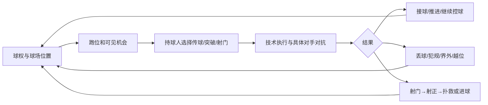

# 球员数据如何影响比赛 · 审批稿 v1

状态：**待用户审批，尚未实现、未启用**。日期：2026-10-16。作者：Codex。

适用基础：已经完成的 0.2.0 球员模型。拟实现引擎：0.3.0。本文中的系数是原创游戏设计的初始参数，并非真实赛事数据拟合结果。用户批准方向后仍需用模拟结果校准；若校准需要改变本文的关键机制或效果上限，应再次提交审批。**不修改现有开发流程。**

## 一、审批摘要：玩家应该感受到什么

1. 速度快的前锋更容易抢到身后空间，但停球差仍可能把球停丢；不能只堆速度。
2. 视野好的球员更容易发现空当，决策好的球员更常作出合理选择，传球好的球员更容易把球传到。这是三个不同环节。
3. 终结好提高机会的兑现率，无球跑动好提高获得机会的能力；前锋可以有完全不同的踢法。
4. 防守站位守通道、盯人跟目标、预判截线路、抢断处理脚下球。防守不再只有一个总分。
5. 门将的扑救、接球、防空、单刀、指挥和出球分别起作用，善扑点的门将未必适合后场控球。
6. 压迫通过跑动、抢球时间和阵形空当起作用，实际消耗体能；不再额外叠加一个笼统攻击加成。
7. 性格主要决定成长、选择和面对事件的反应。国籍、名气、价格、工资、球衣号码不增加战力。

建议批准：**分层事件模型 + 以下属性分工 + 小幅且封顶的心理影响 + 保存可解释事件**。不要批准为“30 项属性全部加到一次随机掷骰里”。

## 二、比赛如何推进

- 采用 105×68 米的简化二维位置和 5×3 区域战术模板。角色、阵型槽位和球的位置决定基础职责；不做三维物理。
- 用 1 秒步长更新位置、时钟和能量；持球动作持续数秒，只有动作结束或出现拦截、碰撞等事件时结算概率。同一动作只抽签一次，不能每秒重抽到成功为止。
- 传球只与实际有机会触球的拦截者对抗，突破只与附近防守者对抗；不再每分钟用整队平均能力决定射手和结果。
- 所有场上球员按实际位置参与事件。后卫可以在角球中进球；不会因 role=DEF 永远被排除。
- 正反方向使用镜像坐标；开球、半场换边、死球和恢复比赛改变状态。当前方案不承诺完整伤病、换人、加时、VAR 或三维碰撞系统。
- 越位、犯规、两黄变红、定位球和点球作为基础事件处理。红牌后改变场上人数与空间，不额外再扣一遍全队属性。

## 三、30 项能力：简短说明与计算入口

以下“Q”指动作质量分，“位置”指生成场上局面，“选择”指发现/挑选行动。具体公式在第四至七节；属性范围 1–100。

| 数据键        | 属性       | 简短描述                           | 数学入口与边界                                                                                    |
| ------------- | ---------- | ---------------------------------- | ------------------------------------------------------------------------------------------------- |
| finishing     | 终结       | 把禁区内机会转为有威胁射门         | 近射 F=0.75终结+0.25平衡；进入射正和射正后进球两阶段，不改变机会 xG                               |
| longShots     | 远射       | 禁区外控制射门方向与威力           | 远射 F=0.70远射+0.30力量；距离仍降低基础机会质量，不保证远射优于近射                              |
| passing       | 传球       | 将球送到预定目标                   | 地面传球 Q=0.80传球+0.20平衡；同时占传中 Q 的 0.20 和门将出球 Q 的 0.25                           |
| firstTouch    | 停球       | 控制来球、减少停大                 | 控球 Q=0.65停球+0.20平衡+0.15灵活；接到球不等于已经控制球                                         |
| dribbling     | 盘带       | 在对手面前控制球和变向过人         | 突破 Q=0.65盘带+0.20灵活+0.15平衡，与实际防守人的抢断 Q 对抗                                      |
| crossing      | 传中       | 将球送往有用的禁区落点             | 传中 Q=0.80传中+0.20传球；成功后仍要争顶/接球，不直接产生射门                                     |
| tackling      | 抢断       | 在不犯规的情况下处理脚下球         | 抢断 Q=0.70抢断+0.20平衡+0.10力量；也进入拦截 Q 和失败抢断的犯规率                                |
| marking       | 盯人       | 跟住具体对手、减少对方轻松接球     | 盯人位置误差 e_mark=3(1−盯人/100) 米；不再作为额外总防守加成                                      |
| heading       | 头球       | 争高球时判断触球，并把头球顶向目标 | 空中对抗 Q 含 0.30头球；头球射门 F=0.75头球+0.25平衡；两个不同事件                                |
| setPieces     | 定位球     | 处理任意球、角球和点球             | 直接任意球 F=0.70定位球+0.20远射+0.10力量；角球 Q=0.65定位球+0.35传中；点球 F=0.55终结+0.45定位球 |
| vision        | 视野       | 发现直塞、换边和队友空当           | 用于候选机会的发现概率；不再额外提高同一次传球的脚法                                              |
| decisions     | 决策       | 在已发现的选择中权衡收益和风险     | 控制行动效用估计误差与 softmax 温度；不是所有动作统一加分                                         |
| composure     | 镇定       | 被逼抢或面对关键球时保持技术       | 压力技术损失为 10×压力×(1−有效镇定/100) 分；无压力时不额外奖励                                    |
| positioning   | 防守站位   | 守住危险通道和合理防线位置         | 进入防守角色锚点误差 e_def；影响实际线路和射门空间，不重复叠加拦截总分                            |
| offTheBall    | 无球跑动   | 找到接球点、制造身后空间           | 跑位误差 3(1−无球/100) 米；启动延迟 0.2+1.0(1−无球/100) 秒；仍受越位约束                          |
| anticipation  | 预判       | 提前判断来球与进攻线路             | 拦截 Q=0.60预判+0.25灵活+0.15抢断；只有可到达的线路才可参与                                       |
| teamwork      | 团队配合   | 与队友保持阵形和提供支援           | 缩小角色锚点误差，参与协防/接应目标执行；不直接把队友个人技术变高                                 |
| concentration | 专注       | 降低走神、漏人和明显处理失误       | 每个相关决策最多一次“走神”概率；疲劳会提高该概率；不逐秒抽签                                      |
| acceleration  | 爆发力     | 起步和短距离加速                   | a_max=1.5+3.0×有效爆发力/100 米/秒²；在球员移动中体现，不再给突破 Q 叠加速度分                    |
| sprintSpeed   | 冲刺速度   | 长距离追赶和反击上限               | v_max=4.5+4.0×有效冲刺速度/100 米/秒；属于游戏运动参数，不是现实测速换算表                        |
| agility       | 灵活       | 转身、变向以及小范围调整           | 转向可损失速度，并进入控球/突破/拦截及门将扑救 Q；每次用途记录在事件中                            |
| balance       | 平衡       | 身体接触下保持脚下稳定             | 进入控球、突破、传球、射门、接球等对应 Q；没有独立的全场平衡加成                                  |
| strength      | 力量       | 护球、身体争抢和部分远射威力       | 抢断/空中对抗/门将摘球中的接触质量，以及远射 F；不把高力量直接变成速度                            |
| stamina       | 耐力       | 让同样强度下的体能消耗更慢         | 只进入能量消耗率，不额外同时加防守、控球和总评级战力                                              |
| reflexes      | 反应       | 对已经形成的射门作出扑救           | 普通扑救 K=0.75反应+0.25灵活；高球扑救分支改用反应/灵活/制空                                      |
| handling      | 手型与接球 | 将扑救变成稳稳拿住，减少脱手       | 接球 Q=0.80接球+0.20平衡；用于扑救成功后的抱稳/脱手，以及出击摘球                                 |
| oneOnOnes     | 单刀处理   | 面对单刀选择封堵方式               | 单刀扑救 K=0.65单刀+0.25反应+0.10灵活；替代普通 K，不与普通 K 相加                                |
| aerialReach   | 制空       | 判断并处理高空来球                 | 出击摘球 Q=0.65制空+0.25接球+0.10力量+身高项；高球扑救 K=0.50反应+0.20灵活+0.30制空               |
| command       | 指挥防线   | 帮队友组织防守，而非直接扑救       | 最多缩小本队防守锚点误差 10%；一名在场门将生效，不给全队再加门将分                                |
| distribution  | 门将出球   | 扑住球后发动有质量的进攻           | 门将传球 Q=0.75出球+0.25传球；视野仍单独负责发现目标                                              |

Q 的权重均合计为 1；身高、压力等是另外有界的情境修正。除耐力作为消耗参数外，物理/技术分先按当前能量调整，再进入 Q。

## 四、统一数学规则

### 4.1 对抗不是“70 能力等于 70% 成功率”

定义 σ(z)=1/(1+exp(−z))，logit(p)=ln(p/(1−p))，clip(x,l,u)=min(u,max(l,x))。

对一个有具体对手的动作：

$$p=\operatorname{clip}\left(\sigma\left[\operatorname{logit}(p_0)+\frac{Q_A-Q_D}{18}+C\right],0.02,0.98\right)$$

- p₀：动作情境基线，参考能力均为 50 时的成功率；不是所有动作都从 50% 开始。
- Q_A、Q_D：双方当前动作质量，单位为能力分。
- C：尚未在几何或 Q 中计算的有界情境项，单位为 log-odds；同一影响只登记一次。首版各动作 C 总和限制在 [−0.75,0.75]，规则裁定不受该限制。
- 抢断/盘带正面对抗 p₀=0.50。攻击方与防守方交换时使用同一次抽签的相反结果，不能各自都判赢。
- 无实际拦截者时，传球的 Q_D=50（中性技术基线），仅保留距离等执行难度；不能虚构场外防守者。
- 传球基线：p₀=clip(σ(logit(0.90)−0.035(L−12)),0.25,0.97)，L 为米；直塞另有落点与线路风险，不靠给“直塞”统一无条件加成。
- 控球 p₀=0.96（地面缓球）、0.83（高速来球）、0.72（高球落下），实际速度/高度由来球事件决定。无贴身争球者时 Q_D=50。
- 传中落点 p₀=0.52，以目标禁区中的可达落点为“传中成功”，不能把后续争顶成功也算在其中。

例如 p₀=0.50、C=0 时，质量优势 0/10/20 分对应 50.0%/63.5%/75.2%；不存在“100 对 50 必定成功”。这些数字仅是同一特定动作，不是整场胜率。

### 4.2 体能、压力和心理只在规定位置应用

E 为比赛实时能量，开场 E=现有 fitness；不再同时乘一次赛前 fitness 加成。

$$r_{physical}=0.70+0.30\sqrt{E/100},\qquad r_{technical}=0.88+0.12E/100$$

- 身体细项（除耐力）有效值=原值×r_physical；技术/门将细项有效值=原值×r_technical。截断到 [1,100]。
- 镇定、决策使用心理修正；其他意识属性不统一乘一个士气系数。
- 同一动作的压力修正：Q′=clip(Q−10×P×(1−composure_eff/100),1,100)。P=clip(1−最近实际逼抢者距离/3,0,1)，且只有逼抢者能接近持球人的动作才计入。
- 压力影响控球、传球、传中和射门；不扣纯速度或纯力量。脚法误差之外的空间阻挡另由几何体现。

能量按秒积分：

$$\frac{dE}{dt}=-\frac{0.32}{60}\,R\,H\,(1+0.60u)\,(1.35-0.007\,stamina)$$

- R：门将 0.45、其他球员 1.00；H：低/正常/高压 0.85/1.00/1.20。
- u：当前秒的冲刺强度比例 [0,1]，由实际跑动决定。死球时间只计上述消耗的 20%，不把每秒都当满速冲刺。
- 比赛结束把 E 交给 players 模块结算；本轮既有赛后恢复只执行一次，禁止同时扣旧的“高压固定 12 点”再扣 E。
- 示例：满场、正常压迫、始终有效比赛且不冲刺时，耐力 40/80 分分别消耗约 30.8/22.8 点能量；这是公式对照，不是宣称实际每场固定消耗。

专注造成的偶发失误：

$$p_{lapse}=\operatorname{clip}\left(0.0015\,e^{(50-concentration)/30}[1+0.8(1-E/100)],0.0002,0.012\right)$$

在相关球员执行一次动作或重新承担一次盯人任务时抽一次。发生后只选择一种后果：该次技术 Q −12 分，或该次位置误差 +3 米。**不会直接判送点/丢球，不在下一秒重复抽同一次任务。**

### 4.3 惯用脚与身高

- 使用自然惯用脚：Q 不变。
- 被迫使用逆足：Q×[1−0.18(1−weakFoot/100)]。逆足 40/80 分的质量系数分别为 0.892/0.964。
- preferredFoot=both：两侧都使用 0.95+0.05×weakFoot/100，避免只因枚举值为 both 就把隐藏能力强行改成 100。
- 只有实际用脚的传、控、带、射事件应用逆足修正；头球、徒手扑救和跑速不受影响。引擎依据来球方向与身体朝向决定是否被迫逆足，不能为了平均数每次随机罚一脚。
- 空中身体接触的身高项 B_h=clip(0.6(heightCm−180),−6,6) 分。只进入空中争顶和摘高球的 Q，不进入地面盘带、力量或普通射门。
- 空中对抗 Q=0.40力量+0.30平衡+0.30头球+B_h。所有可到达球落点的争抢者使用一次 softmax 竞争：P(i)=exp(Q_i/18)/Σexp(Q_j/18)。只有一个实际胜者；门将出击是其中一名参与者。不能先判攻方争顶赢，再独立判防方也赢。

## 五、意识、位置与行动选择

### 5.1 移动和跑位

每秒速度变化不超过 a_max；速度不超过 v_max。转向 φ 弧度后保留速度比例：clip[1−0.50(φ/π)(1−agility_eff/100),0.50,1]。不得瞬移到计算出的最佳接应点。

- 防守锚点误差标准差：e_def=(1−positioning/100)[2.5+2(1−teamwork/100)](1−0.10command_GK/100) 米。
- 盯人目标误差标准差：e_mark=3(1−marking/100) 米。
- 攻方跑位误差标准差：e_run=3(1−offTheBall/100) 米，另有表中的启动延迟。
- 每次攻守阶段转换时固定抽取二维、零均值误差，再由实际移动逐步追上；不是每秒重新抽取“瞬移误差”。标准差是每个坐标轴的参数，误差向量长度截断在 6 米内。
- 阵形锚点与盯人目标按战术模板混合。默认 0.65 锚点+0.35 盯人；防守方没有必须跟随的目标时回到锚点。位置和盯人的影响在几何中生效后，不在 Q_D 里再加一遍这两项。
- 接应候选区域的空间值=0.50×最近防守者距离（10 米封顶并归一）+0.30×纵向进度+0.20×球门开角/π。无球属性决定执行误差，不绕过身体速度限制。

### 5.2 先发现，再选择，再执行

直塞、换边等非显然机会 j 的发现概率：

$$P(discover_j)=\sigma[\operatorname{logit}(0.80)+(vision-50)/20-1.2\,obscurity_j]$$

obscurity∈[0,1] 表示空间被对方站位遮蔽/窗口短暂；最近的可用安全接应始终作为候选，不会因为看不到直塞就停止比赛。每个窗口只判一次，窗口未变化不能无限重复抽到发现。

对发现的行动 a，估算：

$$U(a)=p_{success}(a)V(next)-V(current)-(1-p_{success}(a))V(counter)-cost(a)+T(a)$$

- V 为手工设计、单调向危险区增加的球权价值表 [0,1]；不是直接把 possession% 当成得分。首轮从本方底线向对方禁区的五条纵向带，左/中/右初值为 (0.01,0.02,0.01)、(0.025,0.04,0.025)、(0.05,0.07,0.05)、(0.08,0.13,0.08)、(0.12,0.30,0.12)。
- 射门行动的成功指进球，成功后 V(next)=1；其他行动的成功指完成并控球。反击风险由丢球位置和防线实际人数估算；不把所有失败都视作对手进球。
- cost=0.01×clip(本动作额外能量成本/1点,0,1)。T∈[−0.04,0.04] 为经理选择的进攻风格偏好，只改变选择，不修改实际技术成功率。
- 决策误差 ε_a~Uniform[−0.20(1−D/100),+0.20(1−D/100)]；每个候选评估一次。
- P(a)=softmax[(U(a)+ε_a)/τ]，τ=0.12+0.25(1−D/100)。D 为有效决策。实际结算仍由真实 p_success 和种子决定；球员不会预知随机结果。

控球风格更倾向安全接应；反击增加向前选项偏好并利用未落位的对手；边路扩大接应与传中目标；均衡没有额外偏好。只有当前存在的合法行动才可被选中。

## 六、射门、xG、门将与定位球

### 6.1 区分“机会好不好”与“谁来踢”

机会 xG 仅描述中性射手与中性门将在当时局面下的机会；不包含终结、门将反应、名气或工资。射手和门将个人能力在后续兑现概率中体现。

设 d 为到球门中心距离（米），θ 为左右门柱向量的夹角（弧度），b 为射门通道阻挡程度 [0,1]，g 为门将相对合理封堵位置偏离程度 [0,1]，c 为成功倒三角标识，h 为头球标识：

$$q=clip\{\sigma[-2.10-0.09(d-12)+1.80(\theta-0.35)-0.80b+2.50g+0.45c-0.45h],0.005,0.80\}$$

- b 由射手至球门开角范围中的实际可封堵球员与距离计算；g 为门将实际位置偏离合理封堵点的距离/8 米，封顶为 1。这两个参数描述局面，不是球员能力。
- 以上 q 是**待校准的游戏 xG**。球门开角根据实际坐标求 arccos 并作数值截断；不能拿 UI 百分比坐标当米。
- 普通射门 t₀=0.48+0.40q；点球单独取 q=0.76、t₀=0.95。0.76 是建议游戏基线，不声称是真实赛事的固定常数。
- 对普通射门，q≤0.80 保证 t₀≥q，因此下一步 q/t₀ 是合法概率。

### 6.2 两阶段兑现，避免 xG 重复计入

根据事件类型选择射手 F 和门将 K：头球、直接任意球、点球各用自己的分支；普通/单刀/高球扑救的 K 分支不相加。普通运动战脚下射门按距离连续混合：α=clip((d−16)/8,0,1)，F=(1−α)F_close+αF_far；避免在禁区线附近跨一步就更换成完全不同能力。F 使用有效体能属性，并应用一次逆足和一次持球压力修正；K 只按对应属性的体能调整，不套用逆足或持球压力惩罚。

$$p_{target}=\sigma[logit(t_0)+0.40(F-50)/20]$$
$$p_{goal\mid target}=\sigma[logit(clip(q/t_0,0.001,0.999))+\{0.60(F-50)-(K-50)\}/20]$$
$$p_{goal}=p_{target}\,p_{goal\mid target}$$

依次抽射正和射正后的进球；一次射门只有一种最终结果：偏出、扑救、进球。F=K=50 时，除 q/t₀ 的极小数值保护边界外，总进球概率等于 q。F 在两阶段分别承担 0.40 和 0.60 权重，不能又把综合 shooting 分再乘一次。

示例：同一个 q=0.15 的机会，F=K=50 时进球率 15%；F=70、K=50 时约 26.2%；F=50、K=70 时约 6.7%。这不代表整场有同等增幅，因为射门数量和位置还由前面的事件产生。

终结提升不应令“预期进球统计”变高；统计累计 q，实际进球可能高于或低于 q。这能解释“创造了机会但把握不好”，也能区分创造机会和个人射术。

### 6.3 抱稳、脱手、二点球

在未进球且已经射正的扑救后：

$$p_{hold}=clip\{\sigma[logit(0.80)+(Q_{handling}-50)/18-0.70\,shotPower],0.15,0.98\}$$

shotPower 是来球超出普通射门威力的比例 [0,1]，由射门事件而非球员身价决定。接稳则转入门将球权；脱手则产生一个真实落点，进攻与防守球员重新争二点，补射作为新的射门记录新的 q，不能直接强制补射进球。门将出球再使用 distribution 的 Q。

### 6.4 定位球链条

- 角球：定位球/传中决定落点 → 实际到位的攻守球员与门将一次争球 → 控制球或头球射门 → 正常扑救；身高不能跳过其他环节。
- 直接任意球：墙的位置决定 b，用任意球 F；不得同时算成远射再把定位球加一遍。
- 点球：独立机会基线与点球 F，门将 K=0.65单刀+0.35反应；高压情境 P=1 应用一次镇定修正。判罚和是否射入是不同事件。
- 点球大战单独记录，不能给常规赛进球数、常规 xG 或球员常规进球额外加一次。

## 七、8 项性格与近期状态

| 数据                     | 玩家能理解的表现               | 拟采用数学作用                                                                                                                | 是否直接提高技术         |
| ------------------------ | ------------------------------ | ----------------------------------------------------------------------------------------------------------------------------- | ------------------------ |
| 职业态度 professionalism | 平时练得更认真，成长更稳定     | 沿用训练增量中的 0.75+职业态度/200；比赛中不临时加技术                                                                        | 否，长期成长间接影响     |
| 进取心 ambition          | 落后时更愿意主动冒险争取改变   | 仅第 70 分钟后且本队落后，对向前/射门行动 U 加 0.02(进取心−50)/50，对保守行动等量减；改变风险偏好，有得有失                   | 否                       |
| 忠诚倾向 loyalty         | 重视俱乐部关系与未来去留       | 直接比赛系数=0；留给互动、续约与归属变化设计，当前不强行挂钩跑动或射术                                                        | 否                       |
| 情绪稳定 temperament     | 遭遇不利判罚后更少情绪化抗议   | 每次本人受影响的明确判罚最多一次，p_dissent=clip[0.008 exp((50−情绪稳定)/30),0.0015,0.04]；抗议不自动等于红牌，按纪律事件处理 | 否                       |
| 领导力 leadership        | 困难时稳定队友                 | 一名在场队长令负面士气冲击乘 (1−0.15领导力/100)；最多减轻 15%，不叠加多个领袖                                                 | 否                       |
| 社交意愿 sociability     | 社交、互动与表达频率不同       | 直接比赛系数=0；不能把内向自动解释为团队配合差                                                                                | 否                       |
| 适应能力 adaptability    | 新加盟后更快适应环境           | 新增适应度 A；每日 A 增加 (2+0.06适应能力)/7，上限100；仅游戏日推进时增长，不靠重复杯赛刷适应                                 | 通过小幅心理修正间接影响 |
| 抗挫能力 resilience      | 失误和失利后不容易一直失去信心 | 负面信心冲击乘 clip(1.25−0.0075抗挫能力,0.50,1.25)；不抹去已发生的失误                                                        | 否                       |

若未指定队长，首次使用在场领导力最高者；被罚下后自动由下一名在场者接任，不叠加两名队长效果。指定队长的界面属于后续实现时需要单独明确的功能，不在此次文档中暗改现有操作。

近期状态的统一限制：

$$\delta_{mental}=clip[2(M-50)/50+1.5(C-50)/50-4(1-A/100),-4,3]$$

- M=士气、C=信心、A=适应度，均为 [0,100]。只给镇定、决策加 δ_mental 后截断 [1,100]，不再乘全队战力。
- 信心高不是百分百进球。一次比赛内士气和信心各自净变化限定为 [−10,+10]；避免丢一个球后连锁崩盘。
- 建议事件冲击：本队进球/丢球的士气 +2/−2；本人进球信心 +3；本人明显技术失误信心 −2。普通每次丢失球权不都计为“明显失误”。先应用队长/抗挫机制，再计入本场净变化上限。
- wellbeing.clubAttachment（归属感）直接系数=0；不因为刚加盟或忠诚低就认定“不努力”。适应度与归属感语义分开。
- 旧档已有球员 A=100，新签约球员 A=70，初始世界球员 A=100；国籍完全不参与该值。市场球员在签约前没有俱乐部适应惩罚。
- 对 AI 与玩家队伍使用完全相同公式和状态结算；禁止只给玩家队伍扣体能/士气。

## 八、其他每项球员数据的影响与零影响清单

| 字段                               | 比赛中的作用                   | 数学/约束                                                                                                                   |
| ---------------------------------- | ------------------------------ | --------------------------------------------------------------------------------------------------------------------------- |
| id                                 | 连接首发、事件与统计的唯一身份 | 不提供能力；随机子流不使用姓名/号码/身价作种子                                                                              |
| name、number                       | 展示与辨认                     | 竞技系数均为 0                                                                                                              |
| role                               | 阵型职责和默认站位             | 决定战术模板及参与机会；不把不擅长位置的球员硬赋一个总能力加成                                                              |
| birthDate、age                     | 游戏日计算年龄及长期培养       | age=游戏年份−出生年份−尚未到生日；沿用训练年龄系数。比赛不再额外乘“年轻快/老将稳”，避免与现有能力重复计入；自然衰退另案设计 |
| nationality                        | 虚构身份、未来赛事资格等       | 对能力、成功率、适应惩罚、随机犯规的直接系数均为 0                                                                          |
| heightCm                           | 空中接触范围的有界优势         | 只用第四节 B_h；没有“高个全面更强”                                                                                          |
| preferredFoot、weakFoot            | 特定动作是否被迫使用弱侧       | 只用第四节脚法项，不影响头球/跑速                                                                                           |
| fitness                            | 开场能量 E 的初值              | 比赛中由 E 消耗，不把它再乘一次历史旧的 fitness 系数                                                                        |
| potential                          | 长期成长上限                   | 只限制训练；当前能力 55、潜力95，不能在比赛中按95计算                                                                       |
| skills 六项摘要                    | 兼容旧档、档案和简易推荐       | 新事件引擎不再读取六项摘要决定胜负，防止细项与摘要重复加权                                                                  |
| 综合 rating（派生）                | UI 参考、沿用自动首发参考      | 不进入事件公式；高评级不保证每种战术都合适                                                                                  |
| goals、assists、apps               | 保存生涯/赛季表现              | 只统计，不把“已有很多进球”再变成射门加成。助攻从实际最后有效传球事件确定，点球大战不计入                                    |
| form                               | 近期表现摘要                   | 直接比赛系数=0；以后从真实事件推导展示，不能用随机评分再反过来提高能力造成滚雪球                                            |
| wellbeing.morale/confidence        | 短期心理                       | 只用 δ_mental，且净变化封顶                                                                                                 |
| wellbeing.clubAttachment           | 归属与后续互动                 | 直接比赛系数=0                                                                                                              |
| publicProfile.mediaStyle/interests | 表达风格与生活喜好             | 直接比赛系数=0，不因爱玩游戏/穿搭而暗扣职业态度                                                                             |
| publicProfile.popularity           | 公众关注度                     | 直接比赛系数=0；后续粉丝经济不能反向变成射门加成                                                                            |
| wage、price                        | 经营成本与评估价格             | 直接比赛系数=0。比赛能力来自实际球员数据，不来自付费金额                                                                    |

零影响也是明确的设计结果：身份、财务和叙事字段不需要为了“每项都有用”而获得不合理的竞技加成。

## 九、犯规与越位的最低规则边界

- 防守者实际尝试抢断且失败后，p_foul=clip[0.18+0.12late+0.10danger−0.0015(tackling−50),0.03,0.55]；late/danger 为该次动作的迟到与危险程度 [0,1]。不是每次传球拦截失败都算犯规。
- 裁判事件把接触分为无犯规、草率、鲁莽和过分力量等类别，再按规则决定自由球/点球及纪律处分；位置决定是否在禁区，不根据“比分落后需要点球”补偿。
- 门将徒手处理高球仅在规则允许的本方禁区情境中作为合法候选；禁区外手球、队友故意用脚回传等限制由规则层处理，不能靠高接球能力绕过。
- 抗议事件可触发相应黄牌；情绪稳定低不直接提高暴力犯规和直接红牌概率。两黄变红，罚下球员退出参与池。
- 越位在队友触球时检查接应球员：在对方半场且比球和倒数第二名对手更靠近对方球门，并实际参与进攻才处理。直接接球门球、界外球、角球等例外按规则处理。
- 引擎采用球员简化参考点，不能声称实现毫米级身体部位判定；复杂“故意触球/干扰对手”等边界要有规则测试，无法明确处理的分支不能直接假称完整 IFAB 实现。
- 规则基准锁定 IFAB 2026/27；以后更新规则须单独记录版本，不能悄悄令旧回放改变。

## 十、模块实现与存档方案（批准后才执行）

| 所属模块                       | 拟新增职责                                               | 不越界的约束                                   |
| ------------------------------ | -------------------------------------------------------- | ---------------------------------------------- |
| players                        | 有效能力、能量、心理与适应度的公开计算；赛后球员状态结算 | 不读取 HTTP/SQLite，不改资金                   |
| matches                        | 位置状态、行动选择、对抗/射门、规则事件、可解释战报      | 不通过整体评级重新决定结果；纯输入+种子可复现  |
| tactics                        | 将现有阵型、风格、压迫翻译为位置模板与选择偏好           | 不重新维护球员能力公式，不在 UI 隐藏加成       |
| competitions                   | 调用引擎，汇总比赛，按原规则结算比赛和日期               | 不复制射门算法；AI 与玩家相同结算              |
| server/storage                 | schema 2→3 迁移与事务保存                                | 旧当前球员适应度100，旧回放不补算；迁移前备份  |
| client/matches、client/players | 显示事件解释、细项贡献和心理状态                         | 只展示服务器保存的结果，不用客户端重演决定赛果 |

- 新增持久字段拟仅为 wellbeing.adaptation，存档 JSON 升至 3；赛内能量、压力、位置和任务缓存是运行态，比赛结束后按需保存快照/事件，不往球员长期属性中乱塞临时字段。
- 战报新增 eventFormatVersion=2、实际比赛秒、动作参与者、位置、动作质量、基础概率、修正来源和结果；开发诊断可保留关键抽签与概率。普通玩家只显示简短说明，例如“逆足处理 + 贴身压迫导致停球失误”。
- 保存完整事件链，前端可以筛选关键事件。关键传球、成功/失败争抢、扑救脱手、助攻、体能与红牌统计从事件聚合，不另随机生成。
- 种子随机数按比赛 seed、动作编号和用途分流；展示随机、日志开关不得消耗竞技随机流。没有直接影响的元数据修改后，竞技结果应保持一致（文字名称除外）。
- 引擎版本、规则版本、参数版本写入新战报；旧 0.1/0.2 回放继续按原事件读取。不会以新算法重算已结束比赛。
- 这是规则与领域职责设计，不添加新审批阶段、CI 流程、强制钩子或自动发布流程。

## 十一、数值验收与反滥用约束

以下是**批准后实现阶段**的验收设计，不是声称已测试了尚不存在的引擎：

1. 局部单调：固定局面下，终结提高不能降低该射门进球率；反应提高不能提高对手该类射门的进球率；耐力提高不能让同等负荷耗能更多。决策属于行为选择，不能要求每一个相同种子的整场比分都单调。
2. 全局用共同种子集进行成对比较，同时报告平均差和95%置信区间。不同规则分支可消耗不同随机事件，不能把单场胜负当成平衡证据。
3. 中性对称队伍交换主客并镜像，扣除另行明确的主场机制后，胜率差目标≤2个百分点；每支队伍对同一状态应用相同规则。
4. 初始联赛的校准目标：每场合计进球 2.2–3.2、射门20–34、射正率约30%–45%、常规传球完成率约72%–88%。这些是试玩平衡目标，不是本文引用的现实联赛统计，也不靠硬性封顶比分实现。
5. +10 专项能力的效果以对应事件为主：不能让抢断+10顺便明显提高远射；高速度低停球应增加接近机会但仍会丢控制，矮个技术型球员应有适合的低平球体系。
6. 心理修正最多 −4/+3 个镇定/决策分，身高最多 ±6 空中质量分，战术选择偏好最多±0.04效用。若需要突破上限，先回报设计变化。
7. 任何技能都不保证成功；规则事件（如合法越位、已经出界）不是概率加成可绕过的技能挑战。没有“消费补偿胜利”“国籍好运”“落后强制进球”。
8. 回放事件进球数等于比分；射正数≤射门数；概率合法且无 NaN；球员不可同时两队触球；退场球员不能继续行动；零时间死循环应被动作编号/比赛时限保护检测为引擎错误，不静默编造比分。
9. 资源目标：在实际 Oracle VM 上测量 4 场联赛一轮的 CPU、耗时与内存，再决定事件密度；建议目标是一轮≤2秒、服务常驻内存≤200MiB。未实测前不宣称达到。长期事件应压缩重复移动，避免每秒保存22人全量快照。
10. 标准23项现有测试继续保留；新增规则验证随实现加入原有测试入口，开发流程不变。

## 十二、请用户审批的三项决定

| 审批项        | 建议                                                                            | 如需调整                                                              |
| ------------- | ------------------------------------------------------------------------------- | --------------------------------------------------------------------- |
| A. 比赛核心   | 批准分层事件+局部对抗，30项能力按上述分工进入比赛                               | 若希望更轻量，可先做区域事件，减少移动细节；会降低跑位/速度的解释精度 |
| B. 性格与心理 | 批准小幅封顶影响，部分字段明确零直接加成                                        | 若希望更戏剧化，可提高临场心理波动，但会降低实力与结果的稳定关系      |
| C. 范围       | 批准传控带射、空战、门将、体能、越位/犯规/基本红黄牌/定位球；互动与粉丝消费另案 | 可先缩减纪律与定位球范围；需同时确认哪些属性暂时只保留模型            |

回复“批准 v1 的 A/B/C”可作为该方案的实施授权，也可按条目修改。**在收到明确批准前，仅维护这份设计稿，不实现或上线新公式。**

## 参考边界

- [Hudl StatsBomb：射门位置、门将/防守者位置和击球高度对 xG 的影响](https://blogarchive.statsbomb.com/news/statsbomb-release-expected-goals-with-shot-impact-height/)：参考其“用机会局面描述机会质量”的分析方向；本文不复制其专有模型或系数。
- [IFAB Law 11：越位](https://www.theifab.com/laws/latest/offside/) 与 [IFAB Law 12：犯规与不正当行为](https://www.theifab.com/laws/latest/fouls-and-misconduct/)：作为基础规则边界，版本为2026/27。游戏事件采样公式是原创设计，不是 IFAB 规则原文。
