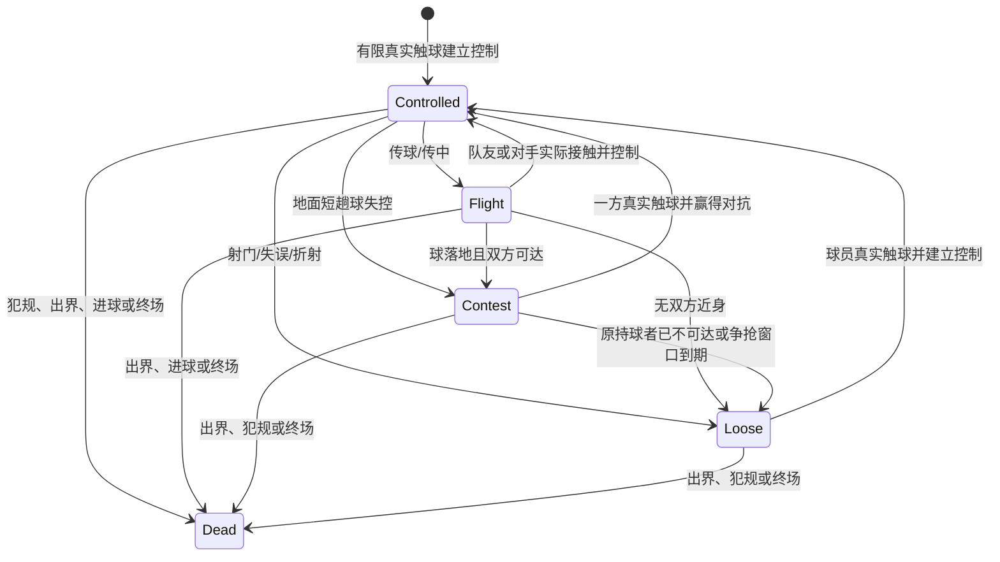

# 0.20.0 持球与球权转换

比赛引擎候选 `0.20.0-possession`，参数 `possession-1`。本版修正的是持球执行和控球阶段转换，不用传球配额、射门配额或总体能力平衡去压制球员选择。球员仍可在空位推进，也仍能传球、突破或射门。

## 三种不同状态

模拟器分别追踪球员真实控制权、球队当前控球阶段和足球所处状态：

球队在传球、射门或失误后最多保留3秒的进攻重组/争回语境；传球仍在有效飞行时沿用接球期限。它只控制团队任务和短暂恢复归属，不能代替实际持球者、脚部接触、抢断窗口或踢球权限。地面球在离开控制时若原持球者距离不超过2.6米、相对球速低于5.5米/秒，可在1.1秒内继续被对手按近身抢断流程挑战；球升高、相对速度过大、原持球者远离或窗口过期都会取消该责任。

同队在窗口内拿到自己射门的反弹球，仍属于同一团队控球片段；若对方真实控制球，立即结束旧片段并记录实际夺回/拦截；若3秒无人控制，结束片段并清除旧球队记忆，随后捡球的一方开启新片段，不再被误记成旧队刚刚丢球。死球立即清空所有控球/争抢上下文。计时统计只将真实控制和有效传球飞行计为球队控球，散球/争抢另外记账。

## 盘带路线评估与真实抢断

盘带路线仍按前方五条路线及战术边路选项评估，并在20%、40%、65%、100%路线点预测双方到达时间。现在两边使用同一`arrivalTime`：应用个人加速度、转向/刹车、实际跑动档、观察反应和当前冲刺恢复；预测防守者不能无视疲劳始终按全速冲刺。到达优势、有效抢断/盘带质量和最多两名近身协防共同进入与实际抢断相同的`duelProbability`。它是候选风险估计，仍不抽取过人结果；实际夺球继续要求真实脚触与抢断流程，由物理接触和真实抢断随机数决定。

此设计保留高盘带、灵活、平衡和冲刺能力对持球的实际价值，也让防守者的抢断、平衡、力量、体能、反应和到达位置在相同对抗逻辑下发挥作用。守门员及其专项仍通过实际身体/手部几何处理；估值本身不修改物理碰撞。

## 验证与兼容

新增测试覆盖短暂带球脱控的近身挑战窗口、不得远程争抢、同队反弹续接、实际对手控制形成转换、无主球窗口过期和疲劳防守者的到达风险。实际比赛专项继续使用固定四种战术×两个种子，记录控球片段/连续传球、带球脱控原因、夺回/拦截、跑动与球员统计，并与已记录的现实口径比较；这些诊断只留在后台，不展示给玩家。没有改JSON/SQLite存档结构、比赛物理常数或球员固定属性；既有战报/轨迹不重算。引擎版本变化会拒绝从旧比赛检查点续算，部署前需等待旧版本比赛任务完成并验证一致备份。
